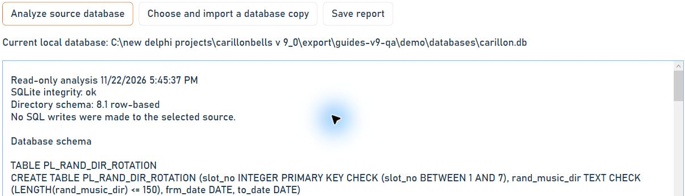

# Release scope and design

This guide is intended for developers and maintainers who need to understand the implementation before changing, diagnosing, or releasing it. It connects the editable WPF interface to the runtime, data, and packaging paths; use the User Guide for operating procedures and the Database Migration Guide for the owner’s installation and recovery steps.

## Purpose and upgrade behavior

Version 9.0 of Westminster Chimes and Carillon Bells is implemented in C# with Windows Presentation Foundation (WPF), replacing the Delphi FireMonkey implementation while retaining the bell system’s established behavior. That behavior includes the grouped playlist, local-time schedules, seasonal dates, rotating random music, weekly and legacy silence, email reports, and original analog clock face.

The single-executable release supports both a new USB installation with a starter database and an in-place upgrade from version 7.2.4 or 8.1. An in-place upgrade runs in the existing folder and uses its database and audio tree, whereas the **Database** tab provides a separate route for read-only analysis and importing a selected database into an existing v9 installation.

## Source map

Begin an investigation with the component that owns the behavior, then follow its calls into the runtime or repository. The responsibilities below provide a starting point without treating the historical FMX implementation as the authority for current code.

- `App.xaml` and `App.xaml.cs` define the WPF resources and startup path, including operating mode, database preparation, and acquisition of exclusive file handles.

- `MainWindow.xaml` and `AdministrationWindow.xaml` contain the editable presentation, with their code-behind binding state, routing user actions, and resolving pending edits.

- `CarillonRuntime.cs` coordinates scheduling, dispatch, silence, logging, and scheduled maintenance, while `Domain.cs` supplies the song model, date and time normalization, path handling, and schedule and calendar rules.

- `CarillonRepository.cs` owns SQLite statements, transactions, compatibility changes, and backups; `AudioPlayback.cs` handles playback and the Windows audio-endpoint integration.

- `EmailReports.cs` and `CarillonLog.cs` provide reporting and diagnostic evidence, while `ClockWindow`, `ClockHands.xaml`, `ThemeManager.cs`, and `Themes.xaml` govern appearance and clock rendering.

- `RegressionTests.cs`, `AudioRegressionTests.cs`, and the build and packaging scripts provide the automated checks used to verify application behavior and prepare deployment artifacts.

The executable validation records under `docs` identify the checks, counts, and deployment scope for each checkpoint, including `migration-root-validation-20261125.json` and `clock-reach-validation-20261125.json`. For the Groups correction, a copied live database reproduced the original failure by reporting 16 Modified rows even though no column values differed.

Validation then covered genuine edits and reversions, calendar interaction, adding and deleting rows, **Save** and **Cancel**, and repeated prompt-free closes of the D: installation, with its existing group records unchanged. Refer to `docs\UI-improvements-checkpoints.md` for the dated evidence and rollback points.

Use the versioned source when resolving questions about current behavior, treating the FMX handoff and original 8.1 publications as historical references. The acceptance matrix distinguishes checks already performed from those that still depend on the deployment environment, so an earlier passing result should be read in the context of the checkpoint it describes.

# Startup and process lifetime

Startup establishes which installation owns the data and audio activity, while shutdown must release that ownership cleanly. Review both paths when changing initialization, lock handling, background work, or endpoint subscriptions so that a second process or late callback does not inherit an ambiguous state.

## Opening an installation

Startup establishes the `en-US` short-date format, `MM/dd/yyyy`, and handles `--self-test` and `--audio-test` before normal initialization so those modes can use dedicated test paths. For normal operation it acquires exclusive handles for `Carillon.lock` beside the executable and `carillon.db.lock` beside the database; because the files can remain after an earlier session, diagnose a startup lock by checking handle ownership rather than file presence alone.

A New Install package supplies `databases\carillon.db` and the time-marking recordings, while the single-executable launch always reads the database in its own installation folder. Detecting a 7.2.4 database leads to one conversion confirmation and a review session with scheduling paused and automatic mail suppressed. A compatible 8.1 database opens through the normal runtime, with a backup taken before any missing dispatch metadata is initialized.

Once the database is ready, startup loads the palette, shows the splash, initializes the runtime, selects the locally saved clock style, and opens the main window. The splash carries the Westminster artwork, product title, and portable-edition caption, while the approved three-bell icon is embedded in the executable and used by the application windows.

All database, log, and playback paths are rooted at `AppContext.BaseDirectory`, including when a shortcut supplies a different working directory. Embedded HTML Help is opened from a temporary copy on the PC, and separate installations on a disk and USB retain independent data.

Use one scheduling instance per Windows audio endpoint during normal operation, since separate copies have independent queues and can both dispatch to the same device.

## Shutdown and power management

The main close path first resolves pending playlist edits, then closes the separate clock window, detaches notifications, and disposes the runtime. Runtime disposal stops the dispatcher timer, cancels background mail, releases playback and endpoint subscriptions, and removes the Windows sleep-prevention request, while `App.OnExit` releases both lock handles. The sidebar’s **Exit** button, the **File** menu, and the window close button all follow this shutdown path.

While the runtime is active, `SetThreadExecutionState` requests that Windows stay awake and the 30-second maintenance cadence writes `data\keepalive.txt` to help keep the portable drive active. The operating-system request is released on a clean exit, but neither measure protects against physical removal, loss of power, or device or driver failure. If the timestamp appears stale, inspect the runtime log and process state, and verify the amplifier output separately during onsite audio testing.

# Playlist and administration

The interface keeps selected records and staged edits separate from persisted state. Changes to selection, saving, or pending-edit checks therefore need to preserve both the user’s place in the list and the schedule state that existed before maintenance began.

## Playlist state and editing

`MainWindow` brings together the next-song card, daily counts, active silence, grouped **Songs** list, **Play schedule** editor, and player. Its title bar shows calendar-unit uptime from the last start, while separate wrapping XAML controls give the organization name and date/time room in an automatically growing header. The next-song card places the time above a wrapping title and includes a repeat count when applicable; the footer normally shows **Songs played today**, reconstructed from the play log, although a runtime error can occupy that status line.

Selection is tracked by the composite `playlist_name` and `song_name` key, while the editor works on a cloned `Song` and uses a fingerprint to detect pending changes. This keeps the selected database record distinct from the in-progress edit.

The **PLAYER** display binds to `runtime.LastPlayed`, recording the actual audio item when playback starts rather than following the current grid selection; for random music it records the resolved track. Before the first play it shows **No songs played this session**. A fixed 118.5-unit gap after the playback buttons preserves the approved 2.5 cm rightward adjustment, and long titles wrap before the separate **System Volume** boundary.

At the start of an edit session, schedule input receives focus and an enabled queue pauses. **Save** validates and persists the row before reloading the collection, whereas **Cancel** restores the selected row’s saved values; finishing the edit restores the preceding schedule state, including leaving an already paused queue paused.

When the collection reloads, the window preserves the selected key, search, group expansion, and scroll offset where possible, allowing for the effective key to change after a playlist edit. Navigation follows the visible records under the current filter, **Add files** reads duration through the normal decoder, and **Delete** removes only the playlist row while retaining the audio file.

## Administration state

`Administration` presents tab-specific `DataTable` views for groups, settings, random folders, and weekly silence, treating those views as staged UI state. Before **Save**, it commits active cell and row edits and validates dates, enabled silence windows, and other required fields. Settings updates are limited to changed columns owned by **System** and **Email / reports**, while each of the three owned data grids writes transactionally per table; inspect a reported save failure before continuing rather than assuming every pending table was committed.

Most Administration pages pause scheduling, with **Themes**, **Clock hands**, and **Fonts** remaining exceptions when opened without moving to another tab that requires a pause. The clock and log windows can remain open while background work continues, and **Cancel changes** reloads committed data before the close flow checks for remaining edits. Theme choices apply to open windows and persist separately, whereas clock-hand choices preview immediately and use **Save** to commit.

## Calendar buttons and real pending edits

The shared `DatePicker` control template retains `PART_TextBox`, `PART_Button`, `PART_Root`, and `PART_Popup`, reserving a 24-unit column for a 22-unit button that is `Visibility Hidden` at rest. Template triggers reveal it for `IsMouseOver`, `IsKeyboardFocusWithin`, or `IsDropDownOpen`, leaving selection to the native calendar and the symbol to an editable XAML path. Both playlist and group dates use this template, so the hover behavior requires no runtime hover handlers.

`CommitEditors` continues to validate group date text, update bindings, and commit grid cells and rows. A binding can write the same date back to a `DataRow` and mark it `Modified` without changing any values, which is why Groups cannot use `GetChanges` alone as its pending-edit test.

Instead, Groups recognizes `Added` and `Deleted` rows and compares columns between the `Current` and `Original` versions of Modified rows. The implementation neither clears real changes with `AcceptChanges` nor bypasses the close prompt; saving or cancelling establishes the next clean view, while the other administration tables keep their existing change checks.

## Font resources and validation

Font selection is driven by the `BodyFontFamily`, `HeadingFontFamily`, and size resources in `App.xaml`. **Original** retains Bahnschrift for body text and Georgia for headings, with Bahnschrift, Segoe UI, Arial, Tahoma, Verdana, and Calibri offered as alternatives. The integer base-size range is 14 through 20, with 18 as the original base and supporting labels and headings scaled proportionately.

`ThemeManager.CheckFonts` applies candidate resources to appearance-preview copies of the existing XAML windows, whose preview constructors suppress scheduling and disposal side effects. After completing deferred layout, the checker measures full text with `FormattedText` at the minimum supported client sizes, available display work area, and current DPI.

The checks cover song values, administration tabs and rows, visible and masked passwords, date calendars, the schedule overlay, recent log entries, clock menu, and splash. Overflow, clipping, and ellipses do not qualify as fitting, although read-only reports retain vertical scrolling; a failure anywhere rejects the candidate as a whole.

**Apply checked font** rechecks current data, writes `data\fonts.json` through a temporary sibling and atomic replacement, and updates the active resources. Its confirmation names the font and size and states that they are already saved, with the Fonts report and `ResultLabel` retaining that status; changing the candidate invalidates the previous approval, and pending administration edits must be resolved before checking.

Startup and main-window DPI changes revalidate a saved custom choice, restoring **Original** with a notice if it no longer fits. **Original** at size 18 remains the reset path, but these appearance checks do not replace deployment testing at other physical display densities.

# Scheduling and maintenance

Building the day’s schedule and dispatching its occurrences are separate operations, with reports and the live queue using different views of the same rules. Keep that distinction explicit when investigating an omitted event, an apparent duplicate, or maintenance around midnight and clock changes.

## Compiling a day

`ScheduleBuilder` selects records whose inclusive **From** and **Until** dates cover the requested day and whose weekday flag is enabled. Each row offers twelve daily time slots: blanks are absent, midnight is valid, and repeated values within one row collapse into one occurrence. Results are ordered by time, then ordinal playlist and path, so simultaneous events for different songs remain distinct and are serviced sequentially by the player.

The full-day snapshot remains available when dispatch is paused and can include events earlier in the day, whereas a rebuilt live queue excludes times before now and applies the dispatch ledger. Weekly silence has an inclusive end during compilation, while the legacy liturgical and funeral checks also affect playback through the live silence coordinator; keep these separate lifetimes and checks in mind when comparing the displayed day with the remaining queue.

## Dispatch and clock changes

`CarillonRuntime` uses a one-second WPF `DispatcherTimer` with a reentrancy guard, comparing wall-clock movement with monotonic elapsed time. When scheduling is enabled, a timer gap longer than ten seconds, an absolute discrepancy greater than two seconds, or a date change triggers a queue rebuild that skips missed occurrences. Ordinary contention from a busy player instead leaves events available for sequential dispatch.

Each event identifier combines its local `yyyyMMddHHmmss` timestamp with the song’s composite key and is stored with the event date in `Carillon9_Dispatched` before playback, including an event skipped for live silence. This ledger prevents duplicate dispatch after re-enabling or restarting and treats a repeated local time during the autumn clock change as the same occurrence. Because the record precedes playback, a subsequent playback failure requires separate handling.

The title bar calculates uptime from completed calendar months since startup, divides those into years and months, and then reports the remaining weeks, days, hours, minutes, and seconds. Values are clamped to zero if the wall clock moves earlier than startup, while clock artwork uses its own window timer so closing the clock does not stop scheduling.

## Background timing

Scheduled maintenance shares the running process with playback rather than depending on which page is visible. The timings below identify when work becomes due and which startup or once-per-day guards prevent it from being repeated.

- At startup, the runtime trims the play log and reconstructs the current day’s recorded-play count, giving the new session its local history.

- At or after 00:05, daily schedule and count maintenance runs once per running day while scheduling is enabled.

- At or after 00:10, reaching a new day triggers log trimming independently of the playback-logging setting.

- January maintenance recalculates liturgical dates from January 2 at 00:15 and seasonal group dates from January 3 at 00:02, with the running process tracking completion by year. These checks operate during January regardless of which view is open.

- The automatic morning report becomes due at or after 05:00 once per running day, while a process started at or after 05:00 treats that startup date as already handled.

# Seasonal playback and silence

Seasonal group synchronization changes song dates and first play times, random rotation chooses a folder, and silence coordinates exclusions and endpoint mute. Follow those responsibilities separately when diagnosing which recording was selected or why an otherwise eligible event was quiet.

## Seasonal synchronization

`CalendarRules` calculates Gregorian Easter and recognizes fixed and movable holiday groups, including Christmas from December 22 through December 26, Memorial Day on the last Monday in May, and Thanksgiving on the fourth Thursday in November. Recalculation updates recognized names and advances past occurrences while preserving custom group names.

Synchronization matches trimmed seasonal names without regard to case and excludes **Daily List**. For matching rows, the group’s dates and first play time replace the song’s dates and first time, and the remaining eleven time fields are cleared, so investigate the assigned group before treating a disappeared hand-entered seasonal slot as a separate save failure.

## Random directory selection

Random-directory date entry uses `M/d`, such as 10/1 through 10/31, with `DataFormats.AnnualDate` rejecting years, dashes, and impossible dates. A leap-capable reference year allows February 29, while repository normalization continues to store ISO dates, using year 2000 for newly entered month/day values and accepting existing ISO values; matching ignores the stored year.

Slot 1 is the everyday fallback and receives `.\random_songs` in the empty test schema. Slots 2 through 7 are evaluated in order, selecting the first nonempty folder with a matching annual range; both boundaries are included, and a range may cross New Year. The row’s **Browse** button selects a folder that must resolve within the portable installation and is stored as a relative path.

When a song title contains **Random Music Generator**, playback resolves the active folder and chooses a random MP3 directly inside it. A missing folder or one without an eligible recording produces a playback error, so check the override that applied on the failure date before changing the fallback folder.

## Silence coordination

**Silence windows** stores twelve reusable weekly rules, with an overnight rule assigned to its starting weekday and equal start and end times treated as inactive. A Friday rule from 22:00 to 06:00 therefore extends into Saturday morning. Compilation excludes the exact weekly end time, even though live evaluation releases the window at that instant.

**Purpose** entry is measured using the editor’s font and display density, with an M-width reserve to leave spare space. Oversized additions and multiline pastes are rejected without truncating the previously accepted value, while an existing long description can be shortened incrementally. The **Start** and **End** columns each use 105 units and omit redundant inner padding, leaving the remaining space for Purpose.

The separate **System** setting enables the legacy liturgical and funeral intervals. Ash Wednesday and All Souls run from 02:05 to 23:55 on their configured dates, while the Holy Thursday through Holy Saturday interval extends from 02:05 on the configured Thursday to 23:55 on the configured Saturday.

The Ash Wednesday end editor remains in XAML with `Visibility Collapsed`, with `ash_wed_begin` authoritative and manual saves and recalculation copying it to `ash_wed_end`. `SaveSettings` enforces this relationship transactionally, including NULL clearing and legacy-end-only writes; `EnsureCompatibleSchema` detects a stale end, makes the normal ZIP backup, and repairs it to match the start, while an already synchronized database uses the existing fast path.

Funeral silence requires complete dates and times with the end strictly later than the start. The runtime combines active reasons, applies mute on startup or schedule edits, and preserves the requested manual mute through overlapping rules.

# SQLite data migration and recovery

Compatibility work operates on persistent installation data, so its entry points must be understood before changing a schema or replacing a file. The following sections distinguish normal storage, startup conversion, analysis and import, and recovery, including the backup boundaries that protect each route.

## Data model

The repository is the boundary between UI values and their stored representation. Treat display formatting, legacy parsing, normalized storage, and transactional writes as related parts of that contract rather than changing one representation in isolation.

`Microsoft.Data.Sqlite` uses short-lived connections with pooling disabled, parameterized values, and explicit transactions for compatible table writes. Full dates display in U.S. month/day/year order with slashes, annual random-directory dates display as `M/d`, and persisted dates and play times are normalized to `yyyy-MM-dd` and `HH:mm:ss` respectively.

The parser accepts compatible legacy representations, including OLE Automation values, while time entry accepts AM/PM and 24-hour forms. Saving 6:15 PM or 18:15 yields 18:15:00, with 12:00 AM becoming 00:00:00 and 12:00 PM becoming 12:00:00; durations remain intervals and can exceed one day.

- `playlist` identifies a song by the composite `playlist_name` and `song_name` key, stores its group in `season`, and holds daily times in `scheduled_time1` through `scheduled_time12`.

- `seasonalgroups` stores named date ranges and a play time, while `PL_SETTINGS` holds the row keyed by `settings_id` 1, including distinct System and Email field sets and compatible theme colors.

- `PL_RAND_DIR_ROTATION` stores slots 1 through 7 in `rand_music_dir`, `frm_date`, and `to_date`, with the historical wide layout retained as `PL_RAND_DIR_ROTATION_WIDE_BACKUP`.

- `silence_schedule` holds the rule ID, enabled flag, purpose, times, and weekday flags, while `Carillon9_Dispatched` holds the persistent local-date dispatch ledger.

The `samples\empty-schema.sql` resource provides a baseline for disposable databases, while the release starter is packaged as `databases\carillon.db` with basic time-marking entries whose relative paths resolve under Music. The same repository compatibility checks also apply to a separately imported database.

## In-place upgrade

Method A is implemented inside `CarillonBells.exe`, where `App.OnStartup` calls the linked `MigrationEngine.UpgradeLocalDatabase` directly rather than launching the assistant. Installing Upgrade files preserves the database, but starting the main executable can change it; Method B explicitly runs `CarillonMigration.exe` to stage a separate installation and neither reverses an earlier Method A upgrade nor synchronizes later edits between databases.

For version 7.2.4, startup detects the wide random-directory schema, requests conversion approval, and saves a verified `carillon_before_upgrade_*.zip` beside the working database. Conversion retains the original wide table, fills missing compatibility fields and silence slots, and preserves stored schedule times and existing audio. A compatible 8.1 startup adds `Carillon9_Dispatched` when needed and likewise places its pre-change ZIP beside the database.

The in-place backup ZIP contains `carillon.db`, so qualify the upgrade on disposable legacy installations and confirm the preserved snapshot, readable working database, and unchanged music before resuming onsite playback.

## Analysis and import

The separate-folder assistant and the Administration database tools serve different purposes: one stages another installation, while the other analyzes or replaces the current installation’s database. Verify the source, template, and destination involved before following either code path.

Separate-folder migration allows the old installation and v9 template to share a drive root but requires a new direct child destination such as `E:\V9`. The drive root itself, an existing destination, a reserved data folder, and a child of a non-root source or template are rejected.

The assistant fills **Source** automatically when the database is beside the executable, and **Browse database** identifies an installation through `carillon.db`. **Destination** separates an existing parent from a single new folder name and shows the composed path read-only, creating the folder only after validation and staging succeed.

Template copying includes the v9 executables and versioned Documentation guides, with single-file templates excluding older loose Help and unrelated programs or DLLs. For a multifile template, dependencies come from the v9 `deps.json` declarations instead of every executable or DLL in the shared root.

Root-drive regression cases cover 7.2.4 conversion, 8.1 preservation, source hashes, Documentation, dependency filtering, existing and nested destinations, changed-source rejection, and cancellation. The optional `CARILLON_MIGRATION_TEST_ROOT` variable must point to an empty disposable drive root; never use a working USB for these tests.

**Analyze source database** opens the selected file read-only, runs SQLite `quick_check`, and reports whether the rotation table uses the row-based layout. Its scrollable report includes table, index, view, and trigger definitions from `sqlite_schema`, explains SQLite-generated objects without separate SQL, and can be exported with **Save report**. Review the output before sharing it, because schema names and definitions may still be private.

**Choose and import a database copy** first resolves pending administration edits, then opens the source read-only and uses SQLite’s backup API to create a local candidate. Compatibility work adds required columns, establishes a unique settings key, preserves extra tables, fills standard slots as needed, and converts a wide rotation table after renaming it to a preserved backup. Multiple settings rows stop the import for review, and legacy time normalization is applied to the candidate.

Before replacement, the application saves a consistent ZIP of the current local database and validates the candidate’s songs, silence, and settings. It then releases active playback, replaces the database, and reloads, with the prior snapshot available for restoration if replacement or subsequent initialization fails after backup. The final report records the snapshot path and normalized-value count; music must still be copied separately and checked against the paths under the destination executable.

## Recovery and backups

The Database Migration Guide distinguishes resuming an untouched Method B source, restoring a verified original 7.2.4 database with **Restore 7.2.4**, and recovering 8.1 from its complete pre-upgrade ZIP or a carefully identified database-only alternative. Preserve a later complete v9 ZIP first, because restoring an older snapshot does not merge subsequent edits, and a database ZIP alone cannot recover old executables or missing recordings.

The 32-bit and 64-bit builds of `CarillonMigration.exe` provide the same **Restore 7.2.4** workflow, listing dated `carillon_before_upgrade_*.zip` files beside the selected database and accepting a ZIP from another location. Before installation, the assistant checks the original 7.2.4 schema and SQLite integrity, accepting `carillon.db` either at the ZIP root or under `databases`.

Close both `Carillon.exe` and `CarillonBells.exe` before restoration so the assistant can check that the target is eligible and available, create and verify a dated `carillon_before_restore_*.zip`, and replace only `databases\carillon.db`. Database fingerprints are checked again before replacement, stopping the operation if either file changed after review. The existing audio, executables, and upgrade backup remain available, and the user starts `Carillon.exe` when ready to check the restored schedule and sound.

Database import writes its local snapshots under `databases\backup`. To recover a v9 import, close the application and preserve the current database before replacing it with the chosen snapshot, then use **Evaluation** mode to check settings, paths, and upcoming events before resuming onsite operation.

# Audio output and clock visuals

Playback spans managed decoding, callback ownership, and the Windows audio endpoint, so successful scheduling alone does not prove that sound reached the intended hardware. The clock is a separate display surface whose timers and shared resources must remain independent of playback lifetime.

## Decoding and playback lifecycle

`AudioPlayback` uses `Mp3FileReaderBase` with NLayer’s frame decompressor for both MP3 duration reading and playback. WAV input is handled by `WaveFileReader` for PCM, IEEE float, or extensible audio, with samples delivered to NAudio `WaveOutEvent` through a 16-bit PCM provider. Decoder and playback faults return to the runtime for logging and display.

The controller owns one stream and output object, so **Play** stops and disposes the previous item before starting the next and clamps repeats to 1 through 5. `PlaybackStopped` is marshalled to the dispatcher, where ownership is checked before rewinding for remaining repeats or releasing resources at completion. **Stop** clears ownership and unsubscribes before stopping, allowing that ownership check to reject late callbacks; recorded starts contribute to **Songs played today**, with all repeats grouped under the same start.

`SystemAudio` observes the default Windows multimedia render endpoint, subscribes to Core Audio notifications, and rebinds when the endpoint changes. The slider and **Mute** act on the Windows master endpoint, while managed silence retains the user’s requested manual mute and restores it after the final reason ends. Refresh checks the actual endpoint during operation, so playback qualification needs both an endpoint and a safe reference-audio path.

## Clock styles and themes

`ClockWindow` scales the original face through a `Viewbox` over a 1680 × 864 canvas whose pivot is 840,430. `ClockHands.xaml` retains **Original** and eighteen numbered black alternatives with narrower shafts and a 15-unit black hub, using XAML Y transforms to reach the original 217-unit minute-marker radius and 170-unit Roman-numeral depth without widening the shafts. Outlined tips include their stroke thickness in that length calculation.

The gallery uses five columns and compact cards while retaining the right-hand preview geometry. Its 460-pixel style tiles pivot at 230,230 and are offset by 610,200 on the live face; the minute hand advances six degrees per minute, and the hour hand advances thirty degrees per hour plus half a degree per minute. The gallery previews those same drawings at 10:10, and saving a style updates an open live clock through the shared resource.

The selected style ID is stored in `data\clock-hands.txt`, accepting 0 through 18 and falling back to 0, **Original**, when the file is absent or invalid. **Save** writes a temporary sibling before replacing the target, and an existing numbered preference continues to select the same slot when its design is revised. `Themes.xaml` and `ThemeManager` govern palettes, legacy-compatible colors, and separate card tints, leaving these properties and clock geometry editable in XAML.

# Reporting and log diagnosis

Reports and logs provide evidence for operational checks without taking ownership of the live playback queue. Diagnose local report generation, SMTP delivery, and recorded playback separately so that a failure in one is not mistaken for a scheduling or audio failure.

## Mail and health reporting

**Email / reports** owns the enable flag, SMTP host and STARTTLS port, credentials, sender, and separate alert, test, and morning-report recipients. MailKit connects with explicit STARTTLS, authenticates, sends, and records success only after the transport operation returns, exposing invalid settings, connection failures, and rejected recipients as errors.

Address checks identify the relevant sender or recipient field, with **Test recipient** required only by its test-send action and the SMTP username permitted to differ from an email address. A successful send clears a stale **Email failed** status while preserving unrelated errors, and manual sends require confirmation. **Evaluation** suppresses automatic delivery while leaving real playback, endpoint controls, and local reporting active.

The HTML health report builds an independent full-day schedule and includes upcoming events, recorded plays, playlist duration, portable and system drive space, boot and runtime uptime, physical memory, audio output, recent maintenance, and missing-file checks. Use **Preview report** to inspect the local HTML first, then test actual SMTP delivery only with authorized recipients and credentials on the intended network.

## Logs and fault isolation

`CarillonLog` serializes file access and accepts current `en-US` and historical ISO-style timestamps, with **Played Song** entries rebuilding the recorded count and each repeat remaining part of a single recorded play. Schedule-state transitions identify the maintenance reason, including song, group, random-music, silence, email, or database work; switching tabs while already paused records the new reason without duplicating the state transition.

The **Log** window wraps long entries and can refresh while playback continues, without requiring a separate completion entry for each play. Trimming removes entries with valid dates older than the thirty-day cutoff while preserving malformed historical entries for diagnosis.

- For an unavailable track, compare its resolved filename with the executable’s folder, then check the active seasonal slot and relative path before changing stored references.

- For a missing scheduled event, inspect its dates, weekdays, times, queue position, silence rules, time discontinuities, and dispatch-ledger entry before creating another event.

- For silent playback, follow the actual audio endpoint through volume, mute, and active silence reasons, then check for decoder or path errors.

- For startup failure, check the intended installation’s write access, runtime architecture, exclusive handle ownership, and SQLite integrity, identifying the affected copy before selecting an archive for recovery.

# Build and release

A deployable USB package combines the correct architecture’s executables with documentation and, for New Install, starter data and recordings. Keep building, behavioral qualification, payload assembly, and publication as distinct checkpoints, with recorded hashes linking the artifacts that were actually tested.

## Project and build commands

Open `CarillonBells.sln` in a Windows IDE with .NET 10 and WPF support; `CarillonBells.csproj` targets `net10.0-windows`, and `Directory.Build.props` directs intermediates into `dcu` while excluding local output, tools, and private directories from compilation. The icon, splash, and clock assets are WPF resources, with HTML Help embedded in the single-executable edition for immediate use after an upgrade and also supplied as a Help folder in New Install packages.

Run `tools\build.ps1` with Release or Debug, publishing the main executable with `-Publish`, `-SingleExe`, and `-Runtime win-x86` or `-Runtime win-x64`. Each published executable bundles the matching .NET 10 Desktop runtime and native SQLite component. The script prefers `tools\dotnet` when present, otherwise uses the system `dotnet`, and directs CLI settings and NuGet packages into project-local caches, with dependency versions recorded in the lock file and project file.

To publish `CarillonMigration.exe`, use `-MigrationSingleExe` with `-Publish` and the same runtime selection, producing `export\staging-migration-single-win-x86` or `export\staging-migration-single-win-x64`. Place the resulting assistant beside the matching `CarillonBells.exe` so it has the payload for a separate v9 installation; **Restore 7.2.4** runs directly from the migration executable.

Before updating a working installation, make the approved pre-change ZIP, close the application, and validate the build. On the multifile publish path, `-PortableRoot` targets an initialized v9 destination and copies and hash-verifies application files while preserving its database, audio, logs, and data directory.

For the public single-executable USB route, extract the Installer ZIP on the computer and run Setup against the existing installation folder. Loose files for copying directly beside `databases` belong to the advanced manual portable Upgrade ZIP; relocating a working installation instead requires closing it and copying the complete folder.

## Validation and packaging

Run `CarillonBells.exe --self-test` on disposable data before deployment and on each updated installation, checking `regression-results.txt`, its failure count, and the process exit code together. Use `--audio-test` followed by a local reference MP3 to exercise decoding, quiet WAV playback, serial repeats, pause and stop, dispatch while **Clock** is open, time discontinuity, silence, endpoint mute, and cleanup.

These tests use real Windows audio, so run them in a safe test setting and review `audio-regression-results.txt`. When a change affects layouts, resources, editing, database import or restoration, or portability, also exercise those surfaces, including save and cancel and startup from a different working directory.

The four public downloads are Installer ZIPs under `export\downloads\32-bit` and `export\downloads\64-bit`, each ending in `Package_Setup.zip` and containing a self-contained Setup EXE, relevant PDF guide, and `START_HERE.txt`. Users extract the ZIP on the computer and run Setup to install directly into their selected USB folder, without needing a separate loose Setup EXE. **New Install** supplies a starter database and music, whereas **Upgrade** preserves the existing database and recordings.

Keep the application and Migration Assistant executables and manual portable ZIPs in `export\32-bit` and `export\64-bit`, because the portable ZIPs supply required inputs to the Setup build. They may be offered as an explicitly labelled advanced manual-install option, but should not be deleted as duplicates or confused with the Installer ZIPs used by the default website route.

The manual portable New Install ZIP contains `CarillonBells.exe` and the `data`, `databases`, `Documentation`, `Help`, `logs`, and `Music` folders. Check that its starter database contains only the intended time-marking rows and that every referenced recording resolves under Music. The manual portable Upgrade ZIP instead supplies `CarillonBells.exe`, the matching `CarillonMigration.exe`, and Documentation for extraction beside the existing database.

After preparing the current portable ZIPs, run `tools\build_usb_setups.py` to stage their files under `export\setup-payloads`, build Setup, and write the public Installer ZIPs under `export\downloads`. The auditor verifies both ZIP layers, the extracted installer hash, the supplied guide, and every embedded application file, while a shared installation identity allows all four Setups to update a New Install with Upgrade.

**Install**, **Repair**, **Verify**, and **Uninstall** all use the displayed destination folder, with Verify checking the files supplied by that package before Carillon is started. Setup accepts a non-system local drive root or an appropriate subfolder, while protecting the Windows drive root, Windows directories, and network-share roots.

ZIP packaging does not digitally sign these installers or remove Windows security warnings: SmartScreen considers publisher signatures and reputation, and download-origin information can survive extraction. Describe the packages as unsigned rather than trusted by their ZIP wrapper, avoid advising users to disable Windows protection, and consult Microsoft’s SmartScreen reputation and Attachment Manager guidance when planning signing or publication.

Qualification should compare the architectures and hashes of the main and migration executables, both ZIP layers, and every corresponding embedded Setup file. Exercise New Install at a non-system drive root and subfolder, **Verify** after changing destinations and reopening Setup, deliberately missing or damaged files, and Upgrade while checking that database and music hashes are preserved. Both architectures use the same USB layout, but must match the installed Windows system type; check Windows 10 LTSC or Enterprise and Windows 11 installations against Microsoft’s current .NET 10 support table.

Exclude private working databases, credentials, music libraries, diagnostic logs, backups, and scratch output from the public distribution. Keep deployment evidence for physical endpoint removal, USB disconnection, real SMTP delivery, monitor scaling, and long-running operation separate, recording the conditions under which each was actually checked.

## Maintain the guides

Documentation is part of the release payload, so compare the current editable DOCX with its manuscript before regenerating a guide, particularly when the owner has made manual revisions. The manuscripts live under `docs\guides\source`; use `tools\build_guides.py` with a separate output folder to generate drafts, preserving approved wording and layout rather than overwriting a newer canonical document.

In LibreOffice Writer, refresh the table of contents, save the DOCX, and export its companion PDF, checking dotted leaders, page numbers, navigation links, and every rendered page. Keep the approved DOCX files in `docs\guides` and PDFs in `docs\pdf`, from which the portable package collects Documentation.

When publishing a guide revision, update the website and standalone release PDF as well as the DOCX/PDF copies inside every affected portable ZIP and installer payload. Rebuild the installers, refresh their checksums and manifest, and compare all active copies with the approved canonical files before declaring the documentation update complete.
