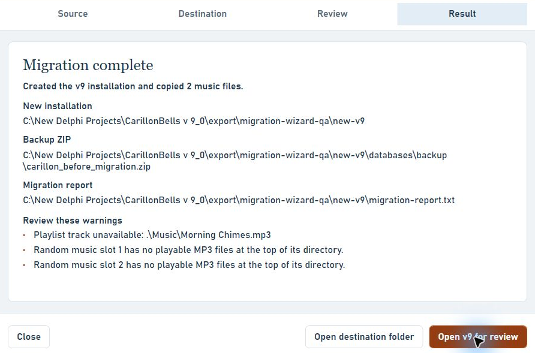
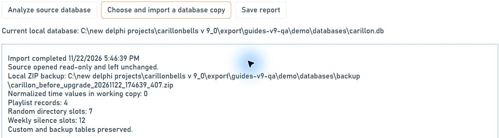

# Plan the migration

Use **Carillon Migration** to create a v9 installation from a working 7.2.4 or 8.1 folder. The wizard copies the database and music, shows which conversion applies, and checks the new music paths. The existing **Database import** option is covered later for users who only need to bring a database into an existing v9 installation.

## What to have ready

- The working 7.2.4 or 8.1 folder and the SQLite database it uses. In a standard portable installation, look for **databases\carillon.db**. Verify which file the running version uses before copying it.
- A complete v9 package for the destination computer. Extract the package before running the wizard. **CarillonMigration.exe** is beside **CarillonBells.exe**.
- A writable destination drive with room for the application, the database and the music. Pick a new folder, such as **D:\CarillonBells_9_0_Migrated**.
- A private backup destination with enough free space for a ZIP of the prior installation and its music. The legacy and v9 databases can contain email credentials.

## Choose the test mode and output

After the wizard finishes, **Open v9 for review** starts the new installation with scheduling paused and automatic email suppressed for that session. Use a test output to check playback before starting the installation normally. If you open **Launch-Carillon-Evaluation.cmd** instead, scheduling starts enabled.

# Use the Carillon Migration wizard

## Choose the source and destination

1. Close the old Carillon application and any other tool using its database. Save and verify a separate ZIP of the old installation before putting the new copy into service.
2. Open **CarillonMigration.exe** from the v9 package or installation. In **Source**, browse to the folder or drive that contains the old application and its database. Click **Next** to check the SQLite database and detect the format.
3. In **Destination**, enter the full path for the new installation. Browse to a parent folder or portable drive to help fill in the path. The last part of the path names the folder the wizard will create. Click **Next**.

## Review and migrate

1. On **Review**, confirm the detected version, database and destination paths, playlist count, and music copy summary. Read any warnings about missing recordings or random directories. Go **Back** to correct the selection if necessary.
2. Check the confirmation box and click **Back Up and Migrate**. The wizard verifies a ZIP of the original database snapshot before it upgrades a 7.2.4 copy. It copies the v9 application files and the available music for the new installation.

To stop a transfer, click **Cancel migration** and wait for cleanup. The wizard makes the new destination available after validation finishes.

## Find the backup and open v9

On **Result**, note the backup under **databases\backup** and **migration-report.txt** in the new installation. Click **Open destination folder** to inspect the files or **Open v9 for review** to launch it with scheduling paused. The result repeats any warnings about music to check before enabling the schedule.

# 7.2.4 to 9.0

The wizard detects the older database form by its random-directory columns. It adds the v9 compatibility fields, converts the numbered columns to seven directory slots, and retains the original wide table in the new database. It creates twelve disabled weekly silence windows if the old database lacked that table and normalizes legacy schedule times on the copy.

After migration, compare the playlist and music groups with 7.2.4. Confirm the fallback in slot 1, the dated overrides in slots 2–7, and the liturgical or funeral silence settings under **System**. Run the checks in **Validate music and schedules** before putting the installation into service.

## Use the 8.1 converter if needed

If a healthy 7.2.4 database fails to migrate, record the error first. If you have the original 8.1 conversion utility, you can test an intermediate upgrade on a separate working database copy. Resolve any integrity errors against a verified backup before attempting either upgrade.

1. Close Carillon. From a separate 8.1 portable installation, start **CarillonDBUpgrade724To81.exe**. Click **Browse** and select the separate working copy of the 7.2.4 database. The utility upgrades the file you select in place.
2. Review the displayed format, check the confirmation box, and click **Back Up and Upgrade**. Keep the resulting backup and conversion report. Verify the converted playlist and settings in the separate 8.1 installation.
3. Close 8.1 and run the v9 wizard with the folder containing the converted database and its music. Keep the original 7.2.4 ZIP for rollback.

# 8.1 to 9.0

The wizard detects the row-based random directory table and copies the 8.1 database with its existing schema and values. Directory slots and weekly silence rules carry over as saved. When v9 first opens the new installation, it can initialize its own settings or runtime records as part of normal startup.

Compare the seven directory rows and twelve weekly silence rows with 8.1. Spot-check enabled rules, purposes, times and weekday selections. Then follow **Validate music and schedules**.

# Import only a database into an existing v9 installation

Use **Database import** when v9 is already set up and you want to replace its local database. Copy music manually in this workflow. For example, if the old playlist refers to **.\Songs\Daily\Bell.mp3**, the v9 folder needs **Songs\Daily\Bell.mp3** beside its executable. Keep the original legacy installation intact and confirm that you have selected the intended v9 copy before importing.

## Analyze the source database

1. Open **Database import** in the v9 sidebar. The **Database** tab shows the current local v9 database path. Confirm that it belongs to the intended destination.
2. Click **Analyze source database** and choose the old SQLite **.db** file. This operation opens the source read-only.
3. Review **SQLite integrity**. An **ok** result is the expected starting point. Investigate other messages or use a verified source backup before attempting import.
4. Review the directory schema line. **8.1 row-based** indicates that the random-directory table already uses individual slots. A legacy wide or missing directory table is handled on the imported copy. The label describes the directory structure.
5. Scroll through **Database schema** to review tables, views, indexes and triggers. The report includes SQLite schema definitions, which can reveal names from custom objects. **Save report** writes the report currently displayed to a text file. Save the analysis before importing if you want to retain both reports.

## Use the report to resolve source questions

The analysis is a structural and integrity check. It helps you see whether expected objects exist and how SQLite defines them. Verify playlist rows, file availability, group dates and report delivery through the practical checks later in this guide.

## Import and check the working copy

1. In the same **Database** tab, choose **Choose and import a database copy**. Resolve any pending administration edits if prompted.
2. Select the source **.db** that you analyzed. Choose the legacy database or a verified copy of it.
3. Wait for **Imported copy**. V9 snapshots the source into a temporary candidate, makes compatibility changes to the candidate and validates its core data. It backs up the current v9 database before putting the candidate in place.
4. Record the **Local ZIP backup** path in the import report. Use **Save report** if you want a separate migration record.
5. Review the reported playlist record count, random-directory slots, and weekly silence slots. Compare the playlist count against the source. Expect seven random slots and twelve weekly silence slots.

## Compatibility changes you may see

V9 reuses a valid row-based random-directory table and converts older numbered directory columns into individual slots on the candidate. It retains the old wide table as a backup when it performs that conversion. It provides missing compatibility fields and fills missing standard random and silence slots. A database with multiple settings records requires review before the import can proceed.

Legacy time representations in known schedule columns are normalized to **HH:mm:ss**. A blank time stays absent. An explicit **00:00:00** is midnight. Import keeps custom and backup tables. The source analysis report provides a useful reference if you need to inspect an unfamiliar object after migration.

# Validate music and schedules

## Review the playlist and calendar

Open **Songs** and compare recognizable entries and groups with your starting version. Select representative daily and seasonal records and check their weekday flags, From and Until dates, play times and repeat counts. Use **Music groups** to review group dates and times. When scheduling resumes, group dates and the first group time can be applied to songs in matching seasonal groups.

Check the Windows time, date and audio device. Open **Today's schedule** to review scheduled times and the next occurrence. The remaining queue is live. Enable the schedule on the isolated test output when you are ready to check actual dispatch.

## Check random and manual playback

1. Open **Random music** and check slot 1, the fallback. A fresh v9 database uses **.\random_songs**. If the imported slot is blank, choose the intended fallback with **Browse**. Playback uses slot 1 outside the dated overrides.
2. Check slots 2 through 7 for complete annual date pairs and verify that each populated directory contains MP3 files at its top level. The first matching dated slot takes priority.
3. Use **Browse** on the corresponding row to select a folder inside the running v9 installation. Click **Save** to keep the change.
4. Use **Play** to check examples from the daily and seasonal libraries. Select a **Random Music Generator** playlist entry to check random playback on the date you are testing. Confirm the played file in **Log**.
5. Test a scheduled occurrence with the clock open and confirm it appears once in the playback log. Use only a disposable or deliberately approved test schedule.

## Check silence and reporting

Review all enabled **Silence windows**, including overnight rules and their starting weekdays. In **System**, review the liturgical and funeral settings separately. Look for the expected status in the **Silence window** card before production use.

Review **Email / reports** and use **Preview report** to save an HTML copy locally. Recheck the configured recipients, SMTP connection details and permission to send before using a live email test. The saved clock-hand style belongs to the v9 installation separately from the imported database.

# Move the portable copy and repeat checks

Close the test copy before moving it. Copy the complete working v9 folder, including its database, music, support files, and any saved appearance preferences. Launch the executable on the destination drive. Check that the next event, a manually played song and the fallback random folder resolve under that destination's folder. Open the **Database** tab to confirm the local database path.

Review the Windows output and volume again when connecting a different computer. Re-enable production scheduling only after checking the new instance, the active silence windows and the intended amplifier or output. Avoid running two active schedulers against the same output.

# Troubleshooting and rollback

## Resolve a failed migration

- **Source analysis fails**. Confirm you selected the real SQLite database and that another application has closed it. Check a verified backup if integrity errors persist.
- **The import reports multiple settings rows**. Preserve the source. Have the settings records reviewed in a private working copy before trying again.
- **A track is missing**. Check the full path named by v9, then copy the audio into the correct location inside the running installation. The database import carries records and paths. Music travels with the folder copy.
- **Random music is empty or unexpected**. Verify the first matching annual override for today and the fallback, then verify that the active folder contains MP3 files directly inside it.
- **The imported database opens but scheduling looks wrong**. Check today's date, enabled flags, inclusive play dates, actual weekday flags, group synchronization and active silence rules. Compare with the preserved v9 import report and the old working schedule.

## Roll back the v9 database

1. Disable scheduling and close v9.
2. Preserve a ZIP of the current v9 database if it contains new work you may need.
3. If you used **Database import**, check that the pre-import ZIP contains **carillon.db**. Restore that file to the intended v9 folder as **databases\carillon.db** while v9 is closed. The wizard's ZIP contains the original legacy snapshot. Keep it for recovery with the old version or to start another migration.
4. Reopen v9 in evaluation mode and review the playlist, settings and schedule before reconnecting production audio.

If you need to resume 7.2.4 or 8.1 immediately, close v9 and launch the preserved installation from its own directory. Confirm the original database, schedule and audio output before returning to service.
