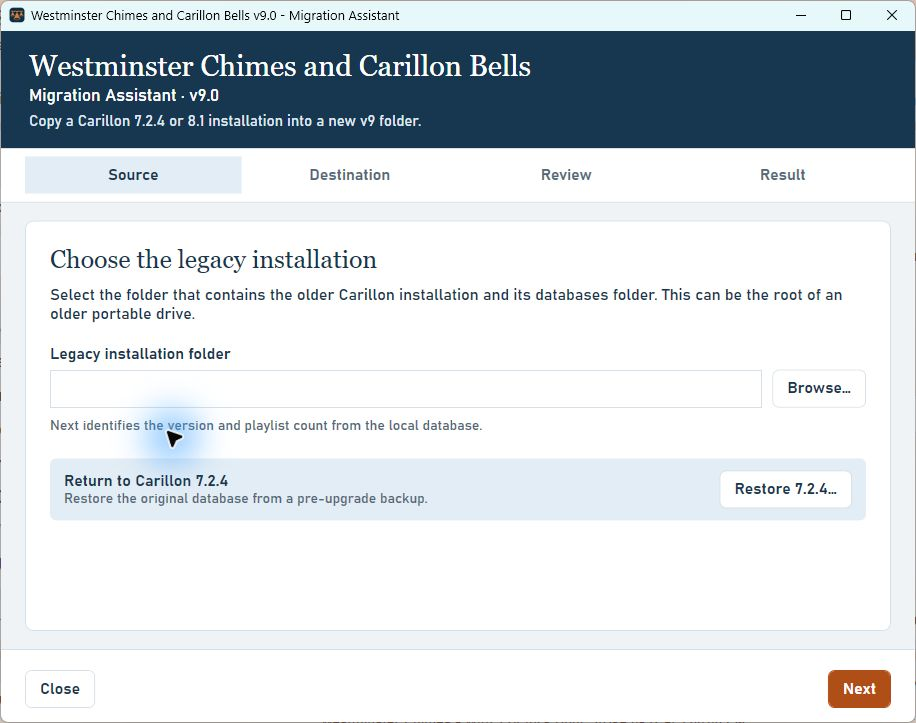

# Start here

This guide helps you move an existing Westminster Chimes and Carillon Bells installation from version 7.2.4 or 8.1 to version 9.0. You will keep the songs and settings you already use, make a backup, and check the new program before returning it to normal service. You do not need to understand how a database works to follow these steps.

The word migration in the title means bringing your existing information into the new version.

The main instructions are for a program that already runs from a USB drive. Read **Choose the right download**, **Find your Carillon folder**, and **Make a backup before upgrading** before changing anything. Then follow **Copy the new program to the USB** and the startup instructions for your old version.

If you prefer to leave the existing installation completely separate while you try version 9, use **Try version 9 in a separate folder** later in this guide. If you are setting up a new USB that has never held your songs and schedules, use the Quick Start Guide instead.

## Three things to recognize

- **Program:** the file you open to start Carillon. The new program is called **CarillonBells.exe**. The ending **.exe** means it is a program Windows can run. Windows may hide that ending and show only **CarillonBells**.
- **Database:** the file that holds your playlist, play times, groups, and settings. Its name is **carillon.db**, and it is normally inside a folder named **databases**. It does not contain the actual recordings.
- **Music folders:** the folders holding the recordings you hear. Your USB may have **Music**, **Songs**, **Random_songs**, or other folders. Keep their names and contents together with the installation.

For example, a playlist can show “Morning Chimes” even when its recording has not been copied. Seeing the song name confirms that the database opened; playing it successfully confirms that the audio file is available too.

The pictures in this guide use demonstration data. Your organization name, song titles, drive letter, and folder names will be different. Follow the button names and the folder relationships rather than trying to make your screen match every example.

# Choose the right download

There are two Windows downloads because different computers need different program versions. The names **32-bit** and **64-bit** describe the Windows installation on the computer. They do not describe the size of your USB drive or the number of songs it can hold.

Check the computer that will actually run the bells. If you download the files on an office computer but run Carillon on a different computer, check the Carillon computer.

## Find the Windows information

1. Click the Windows **Start** button on the taskbar. Open **Settings**, shown by a gear symbol. If you cannot find it, type **Settings** in the Start menu search and open the Settings app.
2. In Settings, select **System**, then **About**. You may need to scroll down to find About. Windows 10 and Windows 11 arrange this page differently.
3. Look under **Device specifications** for **System type**. Read the words at the start of that line.

Here are examples of what you may see and which download to choose:

- **64-bit operating system, x64-based processor:** choose the **64-bit** download. Its filename ends in **win-x64.zip**.
- **32-bit operating system, x64-based processor:** choose the **32-bit** download. Even though the processor says x64, the operating system in this example is 32-bit.
- **32-bit operating system, x86-based processor:** also choose the **32-bit** download. Its filename ends in **win-x86.zip**. In these filenames, **x86 means 32-bit**.

If the line says **ARM-based processor**, or you cannot identify the operating system type, ask for help before downloading. This guide covers the supplied x86 and x64 packages.

## Choose the upgrade package

For an existing USB, choose **USB Upgrade**, followed by the correct 32-bit or 64-bit version. For example, the 64-bit ZIP is named **CarillonBells_9_0_USB_Upgrade_win-x64.zip**. The 32-bit ZIP has the same name except that it ends in **win-x86.zip**.

A **ZIP** is a compressed package holding several files. You will unpack it before using them. If you received **Upgrade Package Setup** instead of the ZIP, run that setup program on the computer and note the folder where it saves the ZIP. Saving the ZIP does not by itself upgrade the USB.

The **USB New Install** download is for starting with a supplied database and chimes. For this procedure, use **USB Upgrade** so you continue with your existing database and music.

# Find your Carillon folder

Windows gives each connected drive a letter. A USB may appear as **USB Drive (D:)**, **Carillon (E:)**, or a similar name. The letter can change when the USB is connected to another computer. Throughout this guide, **D:** is only an example; use the letter shown on your own computer.

1. Close the old Carillon program. Close any other Carillon windows that might be using the same USB.
2. Open **File Explorer**, the folder-shaped icon on the taskbar, and select **This PC**. Find the USB under **Devices and drives** and double-click it.
3. Look for a folder named **databases**. If you see it immediately, the installation folder is the drive itself—for example, **D:\**.
4. If the drive contains a folder such as **Carillon**, open that folder. If **databases** is inside it, that is the installation folder—for example, **D:\Carillon**.
5. Open **databases** briefly and check that it contains **carillon.db**. Click File Explorer's **Back arrow** once to return to the folder you just came from. Leave File Explorer showing that folder.

## Two common arrangements

**Example A:** opening the USB shows **Carillon.exe**, **databases**, and **Music** together. The correct location for the new program is beside those items, such as **D:\CarillonBells.exe**.

**Example B:** opening the USB shows a folder called **Carillon**. Inside that folder are the old program, **databases**, and **Songs**. The correct location is **D:\Carillon\CarillonBells.exe**.

In either example, the new program belongs **beside the databases folder**, not inside it. You should not end up with the program in one location and the working database in an unrelated folder.

If you find several databases folders and do not know which one the old program uses, stop and identify the working installation before proceeding. Guessing can make the new program open an old or empty playlist.

# Make a backup before upgrading

A backup is a saved copy you can return to if the upgrade does not work as expected. Make a ZIP of the complete working installation, including its music, before copying the new program. The database backup created by version 9 is useful, but it does not replace this complete backup.

1. Confirm that the old program is closed. In File Explorer, open the installation folder you identified in the previous section.
2. Press **Ctrl+A** (hold Ctrl and press A) to select the items in that folder. Right-click one of the selected items. In Windows 11, choose **Compress to ZIP file** if shown. On systems using the older menu, choose **Send to**, then **Compressed (zipped) folder**; Windows 11 may put this under **Show more options**.
3. Let Windows finish creating the ZIP. Rename the new ZIP to something you will recognize, such as **Carillon-before-v9-11-23-2026.zip**. Keep the date of your own backup in the name.
4. Copy that ZIP to a folder on the computer or a different backup drive. For example, create **Carillon Backups** in Documents and paste the ZIP there. A backup stored only on the same USB cannot protect you if that USB fails.
5. Open the saved ZIP to check that it contains the expected folders and files. In particular, find **databases\carillon.db** and the music folders. Close the ZIP when you have checked it.

Creating the ZIP needs additional free space where Windows builds it. If the USB is too full, or Windows reports an error, stop and get help making the ZIP directly onto another drive. Continue only after you have a usable backup.

**Checkpoint:** you know where the working installation is, the old program is closed, and a complete backup ZIP is saved somewhere other than the working USB.

# Copy the new program to the USB

First unpack the upgrade download on the computer. This lets you see exactly what you are about to copy.

1. In File Explorer, open **Downloads**, or the folder where you saved the USB Upgrade ZIP.
2. Right-click the ZIP and select **Extract All**. Choose a new folder on the computer, such as **Downloads\Carillon v9 Upgrade**, then click **Extract**. Extract means to unpack the files so Windows can use them normally.
3. Open the extracted folder. You should see **CarillonBells.exe**, **CarillonMigration.exe**, and **Documentation**. Documentation contains the guides. Keep both program files from the same download together.
4. Select those two program files and the Documentation folder, right-click the selection, and choose **Copy**.
5. Return to the USB installation folder you found earlier. Right-click a blank area and choose **Paste**. Wait for copying to finish.
6. Check that **CarillonBells.exe** and the existing **databases** folder are now together in the same File Explorer window. Keep the old program and existing music folders in place.

The USB Upgrade package does not supply a replacement database or replacement music. If Windows asks you to replace **carillon.db**, stop and check that you chose the correct package and destination. If it asks about **CarillonBells.exe** because you previously copied a version 9 program there, confirm that your backup is complete before replacing that program file.

Do not run the new program from inside the ZIP or from the temporary Downloads folder. For the next step, open it from the USB folder that contains your existing databases and music.

**Checkpoint:** the new program is on the USB beside databases, and the complete backup is still available on the computer or backup drive.

# Start version 9 with your existing data

Before opening the new program, select the intended Windows audio output and set the volume low enough for a test. A version 8.1 upgrade can start with scheduling enabled, so a song that is due may play soon after startup. Make this first check at a suitable time, with the bell amplifier disconnected if necessary.

Use the instructions below that match your old version. If you are unsure, check the old program's title or About information before closing it, or ask the person who maintains your installation.

## If you are upgrading from version 7.2.4

1. On the USB, double-click **CarillonBells.exe**. If Windows hides file endings, it may appear simply as **CarillonBells**.
2. A message headed **Upgrade from 7.2.4** says that a backup ZIP will be saved before the database is upgraded. Confirm that the older program is closed, then click **Yes**. Click **No** if you need to stop and check something first.
3. Wait for the main window to open. For this first review session, scheduling is paused and automatic email is suppressed so you can check the result.
4. Open **Log** and note the backup location shown in the upgrade entry. The backup is inside **databases**; its filename begins **carillon_before_upgrade_** and ends in **.zip**. The numbers in the name identify when it was made.

Version 9 adapts the old settings to the format it needs and prepares the random-music and silence entries. Your recordings stay in their existing folders. Continue with **Check the songs and schedule** before using the system normally.

## If you are upgrading from version 8.1

1. On the USB, double-click **CarillonBells.exe**. Version 9 opens your existing database and uses the existing music paths.
2. Once the main window is open, clear the **Schedule enabled** checkbox at the upper right while you inspect the installation.
3. Version 9 may create a dated **carillon_before_upgrade_** ZIP inside databases before adding information that helps prevent duplicate scheduled plays after a restart. If that information is already present, that particular startup may not create a new backup.

Keep the complete backup you made earlier regardless of whether an automatic ZIP appears. It is your record of the installation before this upgrade.

# Check the songs and schedule

Work through these checks while **Schedule enabled** is cleared. Seeing a familiar playlist is a good start, but check both the settings and the actual sound before reconnecting a live output.

1. In the main window, look under **Songs** for several familiar titles and groups. Select a title and compare its weekdays, From and Until dates, and play times with the schedule you expect.
2. Open **Database import** in the sidebar. Read **Current local database**. It should refer to the USB you upgraded—for example, **D:\Carillon\databases\carillon.db**. Close that page after checking the path; you do not need to import anything during this check.
3. At a low test volume, select a familiar song and click **Play**. Confirm that it is the recording you expected, then click **Stop**. Try another song from a different group.
4. Open **Music groups** and **Today's schedule**. Compare important dates and play times, including the first event due after you intend to return the system to service.

If songs are missing or do not play, use **If something does not look right** later in this guide. Leave scheduling paused while you investigate.

# Check the remaining settings

These settings can change what you hear even when an ordinary song plays successfully. Take a few minutes to review them before normal service.

1. Open **Random music**. Slot **1** is the usual music folder. Slots **2 through 7** can choose a different folder during particular date ranges, such as Christmas. Check that the folders are the ones you intend to use and contain recordings.
2. A path such as **.\random_songs** means a folder named random_songs beside the program. For example, if the program is **D:\Carillon\CarillonBells.exe**, that music folder is **D:\Carillon\random_songs**. Do not type the example drive letter unless it matches your USB. If you use Browse to correct a folder, click **Save**.
3. Open **Silence windows** and check the enabled days and times. Under **System**, also review liturgical and funeral silence dates. A current silence period can intentionally mute the system even when the player is running.
4. Open **Email / reports**. Use **Preview report** to choose where to save the report, then open that saved file to review it. It is an HTML file, which opens in a web browser. Check the organization, playlist information, and missing-file messages. Preview does not send email.
5. If you use email, confirm the recipient addresses before choosing **Test morning report**. That test sends a real message after confirmation. Check that it arrives at the intended address before relying on automatic reports.

**Checkpoint:** familiar songs play, the correct database is open, important play times are correct, and the random-music, silence, and report settings have been reviewed.

# Return the system to normal use

Choose a suitable time to reconnect the intended speakers or amplifier. Keep the old Carillon program closed; do not run two versions against the same database.

1. If you just upgraded from **7.2.4**, close the first review session and reopen **CarillonBells.exe** from the USB. The automatic email suppression for that review session ends when you restart normally. Clear Schedule enabled again if you still need time to finish checking.
2. Confirm the Windows output and volume, then check **Schedule enabled** when you are ready for automatic playback.
3. Look at **Today's schedule** and the **Next song** card. Confirm that an upcoming song and time are reasonable. Allow one scheduled event to run through the intended output and look in **Log** for its recorded play.
4. Keep the complete backup and any automatic database ZIPs. Close the application before removing the USB or making a copy of its working files.

If you want an overnight check, leave the computer awake, the USB connected, and scheduling and logging enabled. Normal operation rebuilds the schedule at midnight and performs daily schedule maintenance at or after **12:05 a.m.**. An enabled morning email is attempted at or after **5:00 a.m.**; start the application before that time to test it.

The **Evaluation** footer means automatic email is suppressed. For a normal report test, open CarillonBells.exe directly without an evaluation launcher. A **Migration review** session also suppresses automatic email until you close that review session and start normally. Automatic reports are generated as email HTML; use Preview report if you also want a separate saved file.

# If something does not look right

## The program says the database is missing

Check the location from which you opened CarillonBells.exe. It must be beside the intended databases folder. For example, **D:\Carillon\CarillonBells.exe** should have **D:\Carillon\databases\carillon.db** available. Moving only the program to the desktop does not bring the USB database with it. Close the message and open the program from the correct folder; do not create a blank replacement for your working database.

## The song names appear but a recording is missing

Read the full path in the missing-file message. The database holds a reference to a recording, not the recording itself. Make sure the named Music or Songs folder is present with the same internal folders. A full path beginning with a drive letter may still point to another drive; that drive must be available or the setting must be corrected. Copying only carillon.db cannot bring the music across.

## The player runs but there is no sound

Check Windows output selection, the speaker or amplifier connection, the volume, and mute. In the application, a button marked **Unmute** means the output is muted. Also check Silence windows and the System silence dates. Test through a low-volume output while investigating.

## The database is already in use

Close the older Carillon program, any other version 9 window using that installation, and any database viewer you have opened. Then try again. Do not remove database files to get around this message.

## Windows refuses to open the program or warns about the download

First check that you chose the package for the Windows operating system type, unpacked it, and opened the USB copy. Write down the exact message if the problem continues. Ask the supplier or administrator to verify the file and advise you; this guide does not ask you to disable Windows protection.

# Return to version 7.2.4 if needed

Use this procedure only when the installation was upgraded from **7.2.4** and you have its original pre-upgrade ZIP. Restoring brings back the playlist and settings from the time that backup was made. Changes entered later in version 9 will not be in that older database.

1. Close the old **Carillon.exe** and the new **CarillonBells.exe**. Open **CarillonMigration.exe**, supplied beside the new program in the USB Upgrade package.
2. On the opening page, click **Restore 7.2.4…**. On the restore page, click **Choose folder…** and select the installation folder containing databases. Use the drive itself if databases is directly on the drive.

<!-- page break -->

## Review the backup and restore

3. Under **Pre-upgrade backup ZIP**, select the backup made before the upgrade. Compare its date with when you upgraded. If it is not listed, use **Browse for ZIP…**. An automatic backup normally begins **carillon_before_upgrade_** and is inside databases.
4. Click **Review restore**. Read the database location and selected backup again. If either is wrong, go back and correct it. When both are right, click **Back Up and Restore**.
5. Wait for the completion page. The tool first saves the current version 9 database in a separate ZIP beginning **carillon_before_restore_**, then restores the verified 7.2.4 database. Keep the backup path shown on the result page in case you need the later version 9 changes. Music files and program files remain in place.
6. Open the original **Carillon.exe** and check your songs, schedule, and audio output. Opening CarillonBells.exe instead will offer to upgrade the restored database again.

If the old program reports that a column named **ID** is missing, do not try to repair the database yourself. That message can mean the old program is opening the upgraded database. Use the original 7.2.4 backup and the restore procedure above. If you have no suitable backup, ask for help before changing files.

# Recover version 8.1 if needed

The **Restore 7.2.4…** button is specifically for 7.2.4 backups. Do not use it to restore an 8.1 installation. The simplest record of your old 8.1 setup is the complete backup ZIP you made before upgrading.

Close both programs before recovery. To inspect the old installation without overwriting the current USB, unpack that complete ZIP into a separate, empty folder. Open the original 8.1 program from the unpacked folder and verify its database and music locations. Some saved music locations may still refer to the original drive, so check those before scheduled use.

If you need to replace only the database on the existing USB, preserve the current version 9 database in a ZIP first. The automatic **carillon_before_upgrade_** ZIP, when one was created, contains a file called **carillon.db** from before the change. That file can be restored to the USB's databases folder after the application is fully closed. If you are unfamiliar with replacing files, have the person who maintains the system do this step with you.

If files named carillon.db-wal, carillon.db-shm, or carillon.db-journal remain beside the database after closing the applications, leave them in place and ask for help before replacing anything. They can contain database information that needs to be handled together. Do not delete them as a cleanup step.

After recovery, open the original 8.1 program and check its playlist, schedule, and output before resuming automatic playback. Keep the later version 9 backup until you are sure you no longer need those changes.

# Try version 9 in a separate folder

This optional route creates another installation while leaving the older folder in place. The **Migration Assistant** copies the database and available music into a new folder. **Source** means the existing installation you are copying; **Destination** means the new folder you want the assistant to create.

1. Keep CarillonMigration.exe and CarillonBells.exe from the same 32-bit or 64-bit download together. Close the older Carillon application, then open **CarillonMigration.exe**.
2. On **Source**, click **Browse…** and choose the folder containing the old databases folder. For example, choose **D:\Carillon** if the working database is **D:\Carillon\databases\carillon.db**. Click **Next**.

3. On **Destination**, choose a new folder name. For example, **D:\Carillon9Trial** creates a separate folder on the USB. **Browse parent…** chooses the folder in which the new folder will be created. The final destination must not already exist, and the drive needs enough free space for the copied music.

## Review before copying
4. On **Review**, check the old database location, new folder, detected version, music summary, and any warnings. A warning that a recording is missing means the assistant cannot copy that recording from the path it found. Correct missing files or understand the warning before proceeding.

5. When the locations and warnings are understood, check the confirmation box and click **Back Up and Migrate**. Wait for the result page. Keep the displayed backup ZIP and **migration-report.txt**, a text file describing the copy and any warnings.
6. Click **Open v9 for review**. Check the copied songs, settings, and playback using the checks earlier in this guide. Close the review session and start the new folder's CarillonBells.exe normally when you are ready for service.

# Import a database on its own

This optional operation replaces the database in an existing version 9 installation with a copy of another database. It does not copy the music folders or the older program. If your aim is to bring the whole installation across, use the separate-folder procedure instead.

1. Open version 9 in the installation you intend to change. Select **Database import** in the sidebar. Read **Current local database** carefully; this is the database that will be replaced.
2. Click **Analyze source database**, open the older installation's databases folder, and select **carillon.db**. Analysis checks the selected file without changing it. Look for **SQLite integrity: ok**. This technical wording means the file passed the basic database check; it does not prove that music files exist or that the schedule is correct.

<!-- page break -->

## Import and check the result

3. If analysis reports a problem, stop and ask for help. Otherwise click **Choose and import a database copy** and select the same file. The program validates a copy and backs up the current local database before replacing it.
4. Read the completion report. Compare **Playlist records** with roughly how many entries you expected. **Random directory slots: 7** and **Weekly silence slots: 12** describe the available settings rows; they do not mean you imported only seven or twelve songs.

5. Keep the ZIP listed under **Local ZIP backup**. It contains the version 9 database that was replaced. Use **Save report** if you want to keep the on-screen result as a text file.
6. Make sure the imported song paths can find their recordings, then test several songs. For a relative path such as **.\Songs\Daily\Morning Chimes.mp3**, the corresponding Songs folder belongs beside CarillonBells.exe. Review schedules, silence, and email settings again before enabling normal operation.
