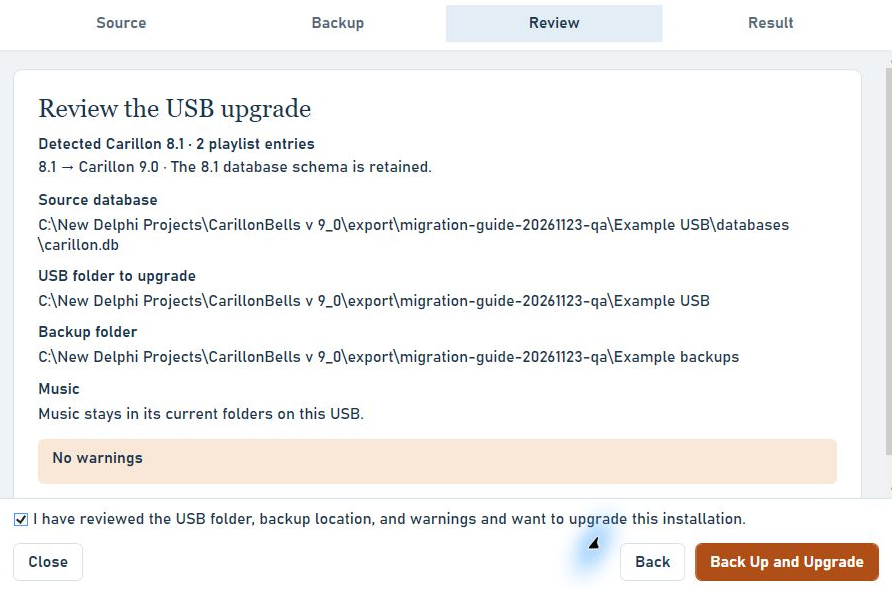
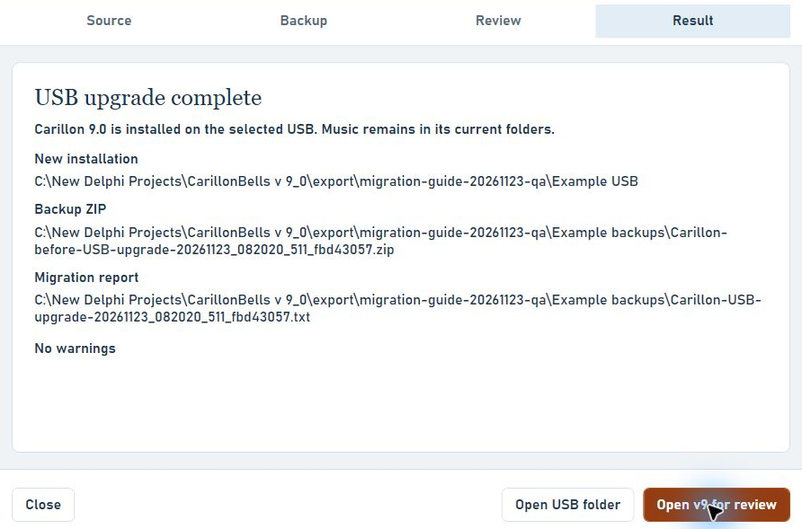
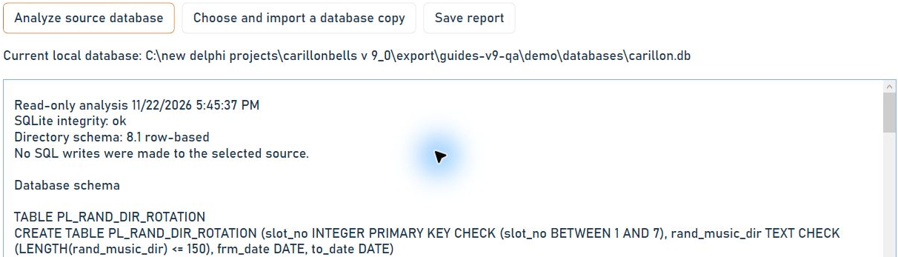

# Prepare the USB upgrade

Use the built-in Carillon 9.0 Migration Assistant to upgrade a working Carillon 7.2.4 or 8.1 USB installation. You will select the existing installation once. The assistant installs v9 in that same folder, reuses its database location and leaves the music in place.

- Have the working USB drive available. Locate the installation folder that contains **databases\carillon.db**. For example, choose **D:\Carillon** if the database is **D:\Carillon\databases\carillon.db**. If **databases** is directly on the drive, choose **D:\**. Use the drive letter shown on your computer.
- Extract the English v9 deployment ZIP to a fresh folder on your PC. The x64 ZIP is for 64-bit Windows and contains **CarillonBells.exe** with the built-in assistant and the supplied audio under **Music**. The USB upgrade uses the music already on your drive.
- Keep a separate drive or PC folder available for the verified pre-upgrade ZIP and upgrade report. The backup covers the database and recognized legacy application files present on the USB. Keep a separate backup of your music if you need to protect those recordings.
- Close Carillon 7.2.4 or 8.1 and any other program using its database.

# Upgrade the existing USB

## Source

1. Double-click **CarillonBells.exe** in the fresh extracted folder on your PC.
2. In **Carillon first start**, click **Yes** when asked whether to upgrade an existing Carillon USB drive. **No** creates an empty database next to the executable you opened. **Cancel** exits.
3. On **Source**, click **Browse** and select the existing USB installation folder. Click **Next**. Check the detected version and playlist count.

## Backup

Keep the default **%LOCALAPPDATA%\Carillon Backups** on your PC, or click **Browse** and choose a folder on another drive. The assistant can create a new backup folder inside an existing location. Click **Next**.

## Review

Confirm the source database, the **USB folder to upgrade**, the version route and the **Backup folder**. Read any warnings and use **Back** to correct a selection. Check the confirmation box and click **Back Up and Upgrade**. The assistant creates and verifies the ZIP before changing the USB. If you need to stop, click **Cancel upgrade** and wait for the assistant to finish cleaning up.

## Result

On **Result**, note the **Backup ZIP** and **Migration report** paths. Both files are in the backup folder you chose. Click **Open USB folder** to see the installed executable.

Click **Open v9 for review** to start v9 from the USB with scheduling paused and automatic email suppressed for the session.

# Upgrade from Carillon 7.2.4

The v9 assistant converts 7.2.4 directly. It converts a temporary copy to the row-based database format, validates the playlist and random-directory slots, and places the converted file at the original **databases\carillon.db** location. The verified ZIP holds the original database for rollback and recovery.

The conversion maps numbered random-directory columns into seven rows and retains the original wide table. It supplies missing compatibility fields, initializes missing weekly silence rows and normalizes legacy schedule times. Compare the fallback, seasonal overrides, playlist and group schedules after the upgrade.

# Upgrade from Carillon 8.1

The assistant leaves **databases\carillon.db** in place and preserves it byte for byte during the upgrade. It installs v9 beside the existing database and music. Opening v9 can then initialize runtime tables or fill missing compatible settings as part of normal startup.

Check the playlist, seven directory slots and twelve weekly silence rows. Compare enabled rules, purposes, start and end times, and weekday selections with your 8.1 setup.

# Verify the upgraded USB

1. In v9, open **Database import** and check that **Current local database** points to **databases\carillon.db** on the USB you upgraded. Verify that several familiar songs and groups appear under **Songs**.
2. Check **Music groups** and **Today's schedule**. Compare representative weekday flags, date ranges and play times. Check the PC clock and the **Next song** card.
3. Use **Play** to check a familiar recording through a test output. In **Random music**, confirm the intended slot 1 fallback and the dated folders in slots 2–7. For a setup that uses **.\random_songs**, verify that folder is present beside the executable and contains MP3 files. If you browse to a corrected folder, click **Save**.
4. Review **Silence windows** and the liturgical and funeral settings under **System**. In **Email / reports**, use **Preview report** to see the report locally and confirm the mail settings before normal use.
5. When ready, use **Schedule enabled** to verify a scheduled event with your test output and check **Log** for the recorded play. For normal operation, close the review session and start **CarillonBells.exe** directly from the upgraded USB. A normal start enables scheduling, so confirm that the old version is closed and the desired output is connected.

For a second portable device, close Carillon and copy the complete working installation, including the executable, database and existing music folders. Run the copied executable and check the local database path and playback. The folders move together even when Windows assigns a different drive letter.

# Recover or roll back

If Carillon reports that the database is in use, close every Carillon window and other database tools, then return to **Source** and review again. If the executable already has a database beside it and opens the main app, close it and start the single executable with **CarillonBells.exe --upgrade-usb** to open the assistant. If a recording cannot play, check the file in the original USB folder and confirm the playlist path or random directory.

To return the upgraded USB to the old version:

1. Close v9 and the old version. Preserve any new v9 changes you may need in a separate ZIP.
2. Open the verified **Carillon-before-USB-upgrade-** ZIP identified on **Result** or in the upgrade report. Extract its **databases\carillon.db** to a temporary folder. Restore that file to **databases\carillon.db** in the USB installation you upgraded. If SQLite journal or WAL files are still present after closing Carillon, have the database files checked before replacing them.
3. Move the v9 **CarillonBells.exe** to a separate folder. If the ZIP contains an earlier **CarillonBells.exe** that was replaced during the upgrade, restore that earlier executable to its original name and location. Use the original legacy launcher. Existing music remains in its original folders.
4. Check the legacy playlist, schedule and output before resuming playback.

# Other migration options

## Make a separate v9 copy

The earlier multi-file v9 package includes **CarillonMigration.exe** for making a separate copy. Select the closed legacy installation, choose a destination folder that does not yet exist, review the planned music copy and click **Back Up and Migrate**. The new folder contains the copied database and music, a database backup under **databases\backup**, and **migration-report.txt**.

## Import only a database into an existing v9 installation

Use **Database import** when v9 is already installed and you need to replace its local database. Arrange the music separately. For example, a record pointing to **.\Songs\Daily\Bell.mp3** needs **Songs\Daily\Bell.mp3** inside the v9 installation.

1. Open **Database import** in the v9 sidebar. Verify the local v9 database path.
2. Click **Analyze source database** and choose the legacy **.db**. Check for **SQLite integrity: ok**. Scroll through the schema to inspect tables, views, indexes and triggers. Click **Save report** if you want to keep the analysis.

3. Click **Choose and import a database copy** and select the database you analyzed. V9 reads the source, validates the candidate and backs up the current v9 database before replacing it.
4. Compare the reported playlist, random-directory and weekly silence counts with the expected data. Record the **Local ZIP backup** path. This backup restores the v9 database that was active before import.

