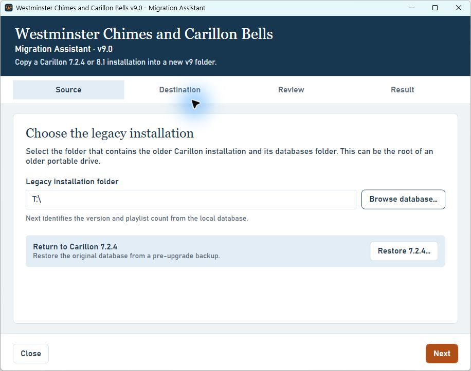
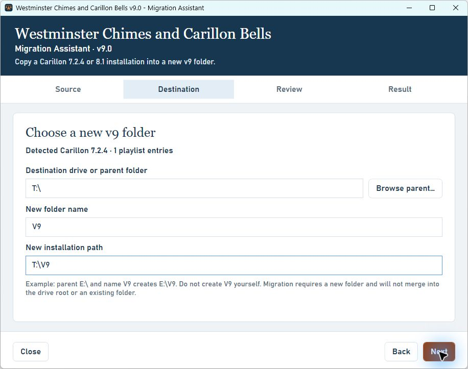
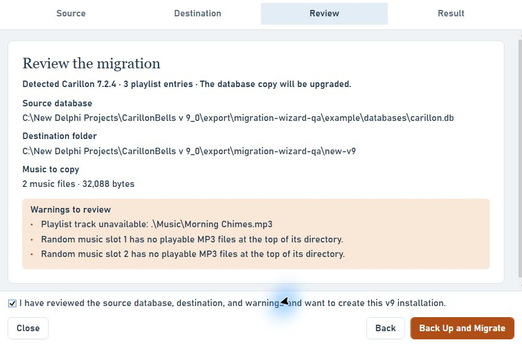
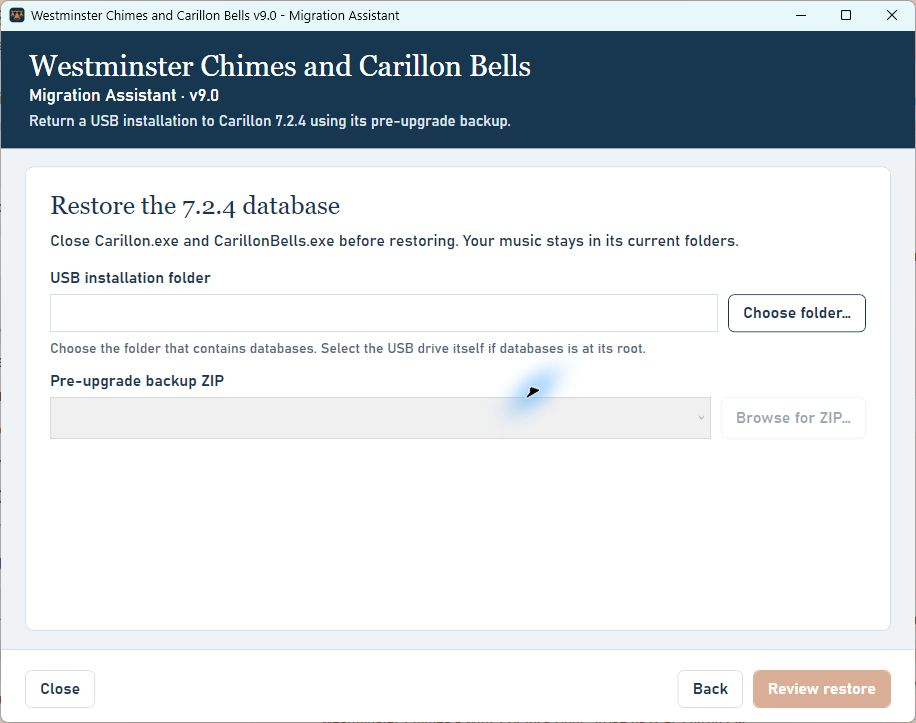

# Read this before starting

This guide is for people who already run Westminster Chimes and Carillon Bells **7.2.4 or 8.1** and want to use **version 9**. It explains two different ways to do that, and how to return to the earlier version. You do not need to understand databases to follow it.

**Choose your method before double-clicking either new program.** Putting the new program files on a USB and starting a program are separate steps. Installing the Upgrade program files does not convert your database. Starting **CarillonBells.exe** beside your old database can convert that working database. The Migration Assistant uses a different method: it makes a separate copy.

## Recognize the three program names

- **CarillonBells.exe** is the version 9 bell program. Use it every day to play songs and run the schedule. It also has its own built-in database upgrade. It does **not** need to launch CarillonMigration.exe to do that upgrade.
- **CarillonMigration.exe** is the Migration Assistant. Use it when you want a separate v9 copy, or when following this guide's **Restore 7.2.4** recovery procedure. It is not the program you use to run the bells each day.
- **A filename ending Package_Setup.exe** is the installer. It puts the supplied program files and guides in the folder you select. It does not itself start the bell schedule or convert your existing database. Its **Verify** button checks installed files; it does not test your songs or schedules.

The old bell program is often called **Carillon.exe**. Keep it and the complete backup described below. Windows may hide filename endings: CarillonBells.exe can appear as **CarillonBells**. Double-click means press the left mouse button twice quickly on the same item; right-click displays a menu.

**Already ran CarillonBells.exe and accepted the 7.2.4 upgrade?** Your working database has already been upgraded. Making a separate copy now will copy that upgraded information; it will not return the original to 7.2.4. Use the recovery instructions if you need the original format back.

# Choose one of the two methods

## Method A upgrades the existing USB

Choose **Method A** if you want version 9 to take over the installation you already use. This is the simplest route for a normal upgrade. You keep the existing database and music in their current locations, install the Upgrade program files beside them, then double-click **CarillonBells.exe** there.

**What to expect:** with a 7.2.4 database, the bell program asks permission, saves a database backup ZIP, converts the working database and starts a review session. With 8.1, it opens the existing database and makes any needed compatibility additions. The existing music stays where it is. This is called an **in-place upgrade** because you continue using the same installation folder.

**What changes:** the database used by this installation can change. The old program file remaining on the USB does not mean its old database is still active. To return to 7.2.4, restore the original database before starting the old program. Recovery instructions are later in this guide.

Follow **Find your Carillon folder**, **Make a complete backup**, **Method A install the Upgrade program files**, and **Method A start the bell program**. You do not need the separate-copy steps.

## Method B creates a separate v9 copy

Choose **Method B** if you want to try v9 while keeping the old working installation available. Double-click **CarillonMigration.exe** and ask it to copy the old installation into a new folder. For example, the old system stays in **E:\** and the new one is created in **E:\V9**.

**What to expect:** the assistant copies the database and available supported recordings, supplies the v9 programs and guides, and prepares the copied database for v9. The original database and recordings are left unchanged by this copy operation. You need enough free space for the additional music copy.

**What changes:** you now have two installations. Changes made in one database do not automatically appear in the other. Choosing this method protects the original only if you have not already upgraded it by running Method A.

After the backup, follow **Method B prepare a separate copy**. Do not start CarillonBells.exe in the old folder first. Starting the wrong copy is the main mistake to avoid.

# Choose the right download

On the Carillon website, **https://carillon-bells.github.io/**, click **Downloads** and check that version 9 is offered. If the page still offers only 8.1, the v9 release has not been published there yet. Keep using the existing installation until the correct download is available.

There are 32-bit and 64-bit Windows downloads because different computers need different program versions. The names **32-bit** and **64-bit** describe the Windows installation on the computer. They do not describe the size of your USB drive or the number of songs it can hold.

Check the computer that will actually run the bells. If you download the files on an office computer but run Carillon on a different computer, check the Carillon computer.

## Find the Windows information

1. Click the Windows **Start** button on the taskbar. Open **Settings**, shown by a gear symbol. If you cannot find it, type **Settings** in the Start menu search and open the Settings app.
2. In Settings, select **System**, then **About**. You may need to scroll down to find About. Windows 10 and Windows 11 arrange this page differently.
3. Look under **Device specifications** for **System type**. Read the words at the start of that line.

Here are examples of what you may see and which download to choose:

- **64-bit operating system, x64-based processor:** choose the **64-bit** download.
- **32-bit operating system, x64-based processor:** choose the **32-bit** download. Even though the processor says x64, the operating system in this example is 32-bit.
- **32-bit operating system, x86-based processor:** also choose the **32-bit** download. In filenames, **x86 means 32-bit**.

If the line says **ARM-based processor**, or you cannot identify the operating system type, ask for help before downloading. This guide covers the supplied x86 and x64 packages.

## Choose the upgrade package

Choose **USB Upgrade Installer ZIP** for the Windows type above. The 64-bit file is **CarillonBells_9_0_USB_Upgrade_win-x64_Package_Setup.zip**; the 32-bit name contains **win-x86** instead.

An **Installer ZIP** keeps Setup, this guide, and **START_HERE.txt** together for downloading. Unpack it on the computer, then let Setup update the USB. You do not need the separate **manual portable ZIP**, which contains loose files for copying yourself. Both Method A and Method B use the Upgrade package. **New Install** supplies a starting database and recordings for an empty USB; do not use it on the working old installation. Make the complete backup below before installing anything.

# Find your Carillon folder

Windows gives each connected drive a letter. A USB may appear as **USB Drive (D:)**, **Carillon (E:)**, or a similar name. The letter can change when the USB is connected to another computer. Both **D:** and **E:** are examples in this guide; use the letter shown on your own computer. **E:\** means the drive itself, also called its root. **E:\V9** means a folder named V9 on that drive.

1. Close the old Carillon program. Close any other Carillon windows that might be using the same USB.
2. Open **File Explorer**, the folder-shaped icon on the taskbar, and select **This PC**. Find the USB under **Devices and drives** and double-click it.
3. Look for a folder named **databases**. If you see it immediately, the installation folder is the drive itself—for example, **D:\**.
4. If the drive contains a folder such as **Carillon**, open that folder. If **databases** is inside it, that is the installation folder—for example, **D:\Carillon**.
5. Open **databases** briefly and check that it contains **carillon.db**. Click File Explorer's **Back arrow** once to return to the folder you just came from. Leave File Explorer showing that folder.

## Two common arrangements

**At the drive root:** double-clicking the USB shows **Carillon.exe**, **databases** and **Music** together. For Method A, put the new program beside them: **D:\CarillonBells.exe**.

**Inside a folder:** double-clicking the USB shows a folder called **Carillon**. Inside that folder are the old program, **databases**, and **Songs**. The correct location is **D:\Carillon\CarillonBells.exe**.

For Method A, the new program belongs **beside the databases folder**, not inside it. For Method B, these examples identify the source to copy; the assistant creates a different destination folder. You should not end up with the program in one location and the working database in an unrelated folder.

If you find several databases folders and do not know which one the old program uses, stop and identify the working installation before proceeding. Guessing can make the new program open an old or empty playlist.

# Make a complete backup

**Do this before either method.** A complete backup lets you recover the program, database and recordings together. The automatic database ZIP contains the database only; it cannot replace lost recordings or an old program file.

The **database**, called **carillon.db**, holds your song list, groups, play times and settings. It normally lives in **databases**. The recordings you hear live in folders such as **Music**, **Songs** or **Random_songs**. A song name in the database does not prove its recording is available. Keep both the database and the recordings.

1. Close the old bell program and every other Carillon window. In File Explorer, double-click the installation folder you identified under **Find your Carillon folder**.
2. Press **Ctrl+A** to select the installation's files and folders. Right-click a selected item. In Windows 11, choose **Compress to ZIP file** if shown. Otherwise choose **Send to**, then **Compressed (zipped) folder**; Windows 11 may put this under **Show more options**.
3. Wait until Windows finishes. Rename the ZIP to identify the original version and backup date, for example **Carillon-7_2_4-before-v9-11-25-2026.zip** or **Carillon-8_1-before-v9-11-25-2026.zip**. Use your own version and date.
4. Copy that ZIP to the computer or another backup drive. For example, in Documents create **Carillon Backups** and paste it there. A backup stored only on the working USB cannot protect you if that USB fails.
5. Double-click the saved ZIP and check its contents. Find the old program, **databases\carillon.db**, and the music folders. If the ZIP has an extra containing folder, double-click that folder to find them. Remember that arrangement for recovery. Close the ZIP after checking.

If Windows cannot create the ZIP, the USB is too full, or a recording is stored on another drive, stop before upgrading. Have the person maintaining the system help you make a complete backup, including any recordings stored elsewhere. Do not format the USB or delete music to make room for this process.

**Checkpoint:** the old program is closed, you know the original version and folder, and the complete backup is saved off the working USB. Keep that backup even after version 9 works.

# Method A install the Upgrade program files

These steps are for **Method A**, which will use the database already on your USB. If you chose a separate trial copy, go to **Method B prepare a separate copy** instead.

## Use the Upgrade Installer ZIP

1. Confirm that the old program is closed and your complete backup is saved. In Downloads or on the desktop, right-click the **USB Upgrade Installer ZIP** ending **Package_Setup.zip**. Click **Extract All**, leave the suggested folder on the computer, then click **Extract**. In the extracted folder, double-click the installer ending **Package_Setup.exe**. Do not run it from inside the ZIP.
2. Click **Continue**, read the license, and click **I accept the license agreement** if you agree.
3. Click the **Install folder** box, press **Ctrl+A**, then type the existing USB installation folder you identified earlier. For example, use **D:\** if databases is directly on D, or **D:\Carillon** if databases is inside Carillon. You can use **Browse** instead. Select the folder beside databases, not databases itself.
4. Check the destination, then click **Install**. Wait for **Install completed**, click **Verify**, and wait for **Verify completed**. Then click **Close**. Verify checks the installation in your selected folder; it does not install anything by itself.
5. In File Explorer, double-click the USB installation folder and confirm that **CarillonBells.exe**, **CarillonMigration.exe**, and **Documentation** are beside your existing **databases** and music folders. Setup has installed the files directly; no second download is needed. Continue with **Method A start the bell program**.

**Choose Upgrade, never New Install, for this working installation.** New Install supplies a starter database and is intended for an empty USB, not for preserving your existing song list.

The Upgrade installer contains no replacement database or recordings. It updates the program and guides, preserving your existing database and music. Always keep the complete backup you made before upgrading.

<!-- page break -->

## Alternative for the manual portable ZIP

First unpack the upgrade ZIP on the computer. This lets you see exactly what you are about to copy.

1. In File Explorer, open **Downloads**, or the folder where you saved the USB Upgrade ZIP.
2. Right-click the ZIP and select **Extract All**. Choose a new folder on the computer, such as **Downloads\Carillon v9 Upgrade**, then click **Extract**. Extract means to unpack the files so Windows can use them normally.
3. Open the extracted folder. You should see **CarillonBells.exe**, **CarillonMigration.exe**, and **Documentation**. Documentation contains the guides. Keep both program files from the same download together.
4. Select those two program files and the Documentation folder, right-click the selection, and choose **Copy**.
5. Return to the USB installation folder you found earlier. Right-click a blank area and choose **Paste**. Wait for copying to finish.
6. Check that **CarillonBells.exe** and the existing **databases** folder are now together in the same File Explorer window. Keep the old program and existing music folders in place.

The USB Upgrade package does not supply a replacement database or replacement music. If Windows asks you to replace **carillon.db**, stop and check that you chose the correct package and destination. If it asks about **CarillonBells.exe** because you previously copied a version 9 program there, confirm that your backup is complete before replacing that program file.

Do not run the new program from inside the ZIP or from the temporary Downloads folder. For the next step, open it from the USB folder that contains your existing databases and music.

**Checkpoint:** the new program is on the USB beside databases, and the complete backup is still available on the computer or backup drive.

# Method A start the bell program

The built-in upgrade below runs inside **CarillonBells.exe**. It does not launch CarillonMigration.exe. Your result can therefore be correct even though you never opened the Migration Assistant.

Before opening the new program, select the intended Windows audio output and set the volume low enough for a test. A version 8.1 upgrade can start with scheduling enabled, so a song that is due may play soon after startup. Make this first check at a suitable time, with the bell amplifier disconnected if necessary.

Use the instructions below that match your old version. If you are unsure, check the old program's title or About information before closing it, or ask the person who maintains your installation.

## If you are upgrading from version 7.2.4

1. On the USB, double-click **CarillonBells.exe**. If Windows hides file endings, it may appear simply as **CarillonBells**.
2. A message headed **Upgrade from 7.2.4** says that a backup ZIP will be saved before the database is upgraded. Confirm that the older program is closed, then click **Yes**. Click **No** if you need to stop and check something first.
3. After you click Yes, the program saves the original database, converts and checks a temporary copy, then makes the converted copy the working database. A short wait is normal; do not unplug the USB. Wait for the main window to open. For this first review session, scheduling is paused and automatic email is suppressed so you can check the result.
4. Open **Log** and note the backup location shown in the upgrade entry. The backup is inside **databases**; its filename begins **carillon_before_upgrade_** and ends in **.zip**. The numbers in the name identify when it was made.

Version 9 adapts the old settings to the format it needs and prepares the random-music and silence entries. Your recordings stay in their existing folders. **Result:** the database in your original installation is now upgraded; there is no separate V9 folder unless you created one by another method. Do not start the 7.2.4 program against this upgraded database. Continue with **Check the songs and schedule** before using the system normally.

<!-- page break -->

## Method A when your old version is 8.1

A normal 8.1 startup can enable scheduling immediately. Choose a suitable test time and turn down or disconnect the bell amplifier first.

1. On the USB, double-click **CarillonBells.exe**. Version 9 opens your existing database and uses the existing music paths.
2. Once the main window is open, clear the **Schedule enabled** checkbox at the upper right while you inspect the installation.
3. Version 9 may create a dated **carillon_before_upgrade_** ZIP inside databases before adding information that helps prevent duplicate scheduled plays after a restart, or before correcting an old Ash Wednesday compatibility end date to match the visible Ash Wednesday date. If that information is already present, that particular startup may not create a new backup.

Keep the complete backup you made earlier regardless of whether an automatic ZIP appears. It is your record of the installation before this upgrade.

**For either original version:** installing or starting v9 does not create a synchronized second copy of your schedule. Keep the complete pre-upgrade ZIP. If you later change songs, dates or settings, the earlier backup will still contain only the information saved at backup time.

# Method B prepare a separate copy

These steps are for **Method B**, which leaves the source database and recordings unchanged. **Source** means the old installation you are copying from. **Destination** means the new folder where v9 will be created. In this example, Source is **E:\** and Destination will be **E:\V9**. Use your own USB letter.

1. Make the complete backup described earlier and close the old bell program. Check that the USB has room for another copy of the recordings.
2. Get the **USB Upgrade Installer ZIP** for the bell computer, as explained under **Choose the right download**. Extract the downloaded ZIP on the computer. Double-click the extracted Setup program and install the Upgrade program files into the existing USB installation folder beside **databases**. Click **Install**, then **Verify**, and close Setup. Upgrade Setup supplies no replacement database or music. **Do not double-click CarillonBells.exe in that source folder.**
3. In that USB folder, double-click **CarillonMigration.exe**. Keep its matching CarillonBells.exe beside it; both come from the same Upgrade package. If you already installed or copied those matching program files, you do not need to install them again.
4. On **Source**, check the displayed old installation folder. It is filled in automatically when the old database is beside the assistant. Otherwise click **Browse database…**, double-click the old installation's **databases** folder, click **carillon.db**, then click **Open**. Selecting **E:\databases\carillon.db** sets Source to **E:\**. If the old database is directly beside the old program, select that carillon.db instead. Click **Next**.

# Method B choose the new folder

1. On **Destination**, check **Destination drive or parent folder**. For our example, this is **E:\**. A parent is simply the drive or existing folder that will contain the new folder. **Browse parent…** lets you select it.
2. Leave **New folder name** as **V9**, or enter another unused name. Check that **New installation path** shows **E:\V9**. This complete path is where the new installation will be created.
3. **Do not create V9 yourself.** The assistant requires a folder that does not already exist and creates it after its checks. If V9 already exists from a previous trial, use a different name such as **V9 Trial**. Do not delete that existing folder to get past the check.
4. Click **Next**. The assistant checks the destination and counts the available recordings before showing the review page.

The separate-copy operation deliberately rejects the drive root, such as **E:\**, as its destination. That prevents it from merging a new database into the old installation. Selecting E as the **parent** is correct; the complete **new installation path** must include V9 or another new folder name. Method A is the route for using the existing installation directly.

# Method B review and create the copy

1. On **Review**, check the **Source database**, **Destination folder**, detected version, music count and warnings. Source and Destination must be different. In our example, Source is **E:\databases\carillon.db** and Destination is **E:\V9**.
2. Read every warning. A missing-recording warning means that recording cannot be copied from the location found in the old database. It does not mean the assistant has recovered the recording. Stop and correct the source or understand what will be missing before accepting the copy.

3. When the information is correct, check the confirmation box and click **Back Up and Migrate**. Wait for **Migration complete**. Do not unplug the USB while it works.
4. Note the **New installation**, **Backup ZIP** and **Migration report** locations on the result page. The database backup is in the new folder under **databases\backup\carillon_before_migration.zip**. Keep it and **migration-report.txt**.
5. Click **Open v9 for review** to start the new copy with scheduling paused and automatic email suppressed. Continue with **Check the songs and schedule**.

# Method B understand the result

You now have **two separate databases**. In our example, the original remains **E:\databases\carillon.db** and the new v9 database is **E:\V9\databases\carillon.db**. Starting a program from the wrong folder can show a different schedule even though neither database has been lost.

- Start **E:\V9\CarillonBells.exe** for the new v9 installation.
- Start the original old program, often **E:\Carillon.exe**, to use the unchanged old installation after closing v9.
- Do not start **E:\CarillonBells.exe** if your intention is to keep the original database in its old format. That is Method A and may upgrade the original.

The assistant copies the database, available supported recordings and the v9 programs and supplied guides. It does not clone every file on the USB. For example, the old executable is left at the source, and a missing recording cannot be copied. Check the warnings and actual playback before relying on the new installation. Saved recording locations can still need attention, particularly paths that name another drive.

**Edits do not move between these databases automatically.** If you change a Christmas date in v9, the old program's database will still have its previous date. If you return to the old version, preserve the v9 folder so you can review those later changes. Do not copy the v9 database over the old one to transfer them.

A copy on the same USB is useful for trying the program, but it is not a backup against USB failure. Keep the complete backup off that USB. Keep both installations until you are satisfied, and run only one bell system at a time so they do not compete for playback or reports.

If you had already run Method A before making this copy, the source was already upgraded. The assistant leaves that current source unchanged; it does not recreate the earlier database. Follow the appropriate recovery instructions below if you need that earlier version.

# Check the songs and schedule

**Time display:** saved play times use 24-hour format. You may type **6:15 PM** or **18:15**; both save and display as **18:15:00**. **12:00 AM** is midnight (**00:00:00**) and **12:00 PM** is noon (**12:00:00**).

Work through these checks while **Schedule enabled** is cleared. Seeing a familiar playlist is a good start, but check both the settings and the actual sound before reconnecting a live output.

1. In the main window, look under **Songs** for several familiar titles and groups. Select a title and compare its weekdays, From and Until dates, and play times with the schedule you expect.
2. Open **Database import** in the sidebar. Read **Current local database**. Method A should show the original folder; Method B should show the new folder, for example **E:\V9\databases\carillon.db**. Close the page without importing anything.
3. At a low test volume, select a familiar song and click **Play**. Confirm that it is the recording you expected, then click **Stop**. Try another song from a different group.
4. Open **Music groups** and **Today's schedule**. Hover over a group date field to reveal its calendar button, or reach it with the keyboard. Opening and closing Groups without editing does not ask to save. Compare important dates and play times, including the first event due after you intend to return the system to service.

If songs are missing or do not play, use **If something does not look right** later in this guide. Leave scheduling paused while you investigate.

# Check the remaining settings

These settings can change what you hear even when an ordinary song plays successfully. Take a few minutes to review them before normal service.

1. Open **Random music**. Its annual From and Until dates now show only month and day, such as **10/1** and **10/31**. These ranges repeat every year; do not add a year. Slot **1** is the usual music folder. Slots **2 through 7** can choose a different folder during particular date ranges, such as Christmas. Check that the folders are the ones you intend to use and contain recordings.
2. A path such as **.\random_songs** means a folder named random_songs beside the program. For example, if the program is **D:\Carillon\CarillonBells.exe**, that music folder is **D:\Carillon\random_songs**. Do not type the example drive letter unless it matches your USB. If you use Browse to correct a folder, click **Save**.
3. Open **Silence windows** and check the enabled days and times. V9 shows one Ash Wednesday date and keeps its hidden compatibility end date synchronized. Under **System**, also review liturgical and funeral silence dates. A current silence period can intentionally mute the system even when the player is running.
4. Open **Email / reports**. Use **Preview report** to choose where to save the report, then open that saved file to review it. It is an HTML file, which opens in a web browser. Check the organization, playlist information, and missing-file messages. Preview does not send email.
5. If you use email, confirm the recipient addresses before choosing **Test morning report**. That test sends a real message after confirmation. Check that it arrives at the intended address before relying on automatic reports.

**Checkpoint:** familiar songs play, the correct database is open, important play times are correct, and the random-music, silence, and report settings have been reviewed.

# Return the system to normal use

Choose a suitable time to reconnect the intended speakers or amplifier. Keep the old Carillon program closed; do not run two versions against the same database.

1. If Method A upgraded **7.2.4**, or you used Method B's **Open v9 for review** button, close that review session. In File Explorer, double-click **CarillonBells.exe** in the installation you chose for service: the original folder for Method A, the new V9 folder for Method B. The automatic email suppression for that review session ends when you restart normally. A normal start enables scheduling, so use a suitable time and keep the test output safe. Clear Schedule enabled again if you still need time to finish checking.
2. Confirm the Windows output and volume, then check **Schedule enabled** when you are ready for automatic playback.
3. Look at **Today's schedule** and the **Next song** card. Confirm that an upcoming song and time are reasonable. Allow one scheduled event to run through the intended output and look in **Log** for its recorded play.
4. Keep the complete backup and any automatic database ZIPs. If you want a different font after the functional checks, open System, then Font settings. Check every page before applying the choice; the confirmation says when it is already applied and saved. Close the application before removing the USB or making a copy of its working files.

For an overnight check, leave the app open, the computer powered on, the USB connected, and scheduling and logging enabled. The app requests that Windows stay awake and writes to the USB periodically to keep it active. Normal background housekeeping does not play songs by itself. Playback follows your saved schedule and silence settings. An enabled morning email is attempted at or after **05:00 (5:00 AM)**; start the app before that time to test it. A physical disconnection or power loss can still interrupt operation.

The **Evaluation** footer means automatic email is suppressed. For a normal report test, open CarillonBells.exe directly without an evaluation launcher. A **Migration review** session also suppresses automatic email until you close that review session and start normally. Automatic reports are generated as email HTML; use Preview report if you also want a separate saved file.

**Record the location you now use.** For example, write down “Daily v9 program: E:\V9\CarillonBells.exe.” If an old desktop shortcut still points to E:\Carillon.exe, it starts the old program. Confirm the shortcut target before relying on it; the copy operation does not switch your old shortcut for you.

# Decide how to return to an earlier version

You might go back because an essential recording does not play, the copied settings need more checking, or you need the familiar system in service while investigating a problem. You do not need to return simply because v9 saved times as 24-hour values; **6:15 PM** and **18:15:00** describe the same time.

**First close v9 and preserve its current installation in a new, dated complete ZIP.** Use the same backup steps as before and keep this later ZIP separate from the original pre-upgrade backup. It preserves edits made since the upgrade. Restoring an earlier database returns its earlier song list, dates and settings; later edits do not merge into it.

Choose the recovery instructions that match what you actually did:

- **Method B, and the original was never upgraded:** follow **Return to the untouched original after Method B**. You normally do not need to restore any database.
- **Method A from 7.2.4:** follow **Restore 7.2.4 after Method A**. Use the assistant's Restore 7.2.4 operation and the original 7.2.4 database ZIP.
- **Method A from 8.1:** follow **Recover 8.1 after Method A**. Restore the complete original installation to a separate folder, or follow the carefully identified database-only recovery steps.

Keep all backups and both versions' files until recovery has been checked. **Do not uninstall the new package, delete databases, rename a database to guess its purpose, or format the USB as a recovery step.** Changing the executable alone does not restore an earlier database.

If you do not know the original version or cannot identify the correct backup, leave the files in place and get help before replacing anything. A backup from the wrong date or a different installation can show the wrong schedule.

# Return to the untouched original after Method B

Use these steps only when the assistant created a separate copy and the original database was never upgraded by starting CarillonBells.exe there. If you already upgraded the original, use the Method A recovery instructions for its earlier version instead.

1. Close **CarillonBells.exe** in the new folder. Keep the new folder and the later v9 backup; you may want its changes or want to resume testing.
2. In File Explorer, double-click the original USB location. For our example this is **E:\**, not **E:\V9**.
3. Double-click the original old program, often **Carillon.exe**. Check its version in the title or About information. **Do not double-click CarillonBells.exe beside it**, because that starts v9 against the original database.
4. Confirm the familiar song list, dates, upcoming play times and Windows sound output. Test a recording at low volume before reconnecting the intended amplifier. Resume the old program's schedule when ready.

**Expected result:** the old program uses its original database and recordings. There is no restore operation because Method B did not replace that database. Changes made only in the new v9 copy remain in that copy.

For example, if the old program is **E:\Carillon.exe**, its database remains **E:\databases\carillon.db**. To resume the trial later, close the old program and start the v9 program in the new folder. The trial copy still has **E:\V9\CarillonBells.exe** and **E:\V9\databases\carillon.db**. Keep track of the folder as well as the program name.

# Restore 7.2.4 after Method A

First save the later v9 installation in a separate complete ZIP, as explained under **Decide how to return to an earlier version**.

Use this procedure only when the installation was upgraded from **7.2.4** and you have its original pre-upgrade ZIP. Restoring brings back the playlist and settings from the time that backup was made. Changes entered later in version 9 will not be in that older database.

1. Close the old **Carillon.exe** and the new **CarillonBells.exe**. Open **CarillonMigration.exe**, supplied beside the new program in the USB Upgrade package.
2. On the opening page, click **Restore 7.2.4…**. On the restore page, click **Choose folder…** and select the installation folder containing databases. Use the drive itself if databases is directly on the drive.

<!-- page break -->

## Review the backup and restore

3. Under **Pre-upgrade backup ZIP**, select the ZIP containing the original **7.2.4** database from this same installation, made before you accepted the v9 upgrade. Do not choose a later v9 backup or an 8.1 backup. Compare its date with when you upgraded. If it is not listed, use **Browse for ZIP…**. An automatic backup normally begins **carillon_before_upgrade_** and is inside databases.
The automatic ZIP contains the database only. It does not contain the old program or music. Keep your complete backup too. The restore tool accepts a ZIP with carillon.db at its top level or directly inside databases. If a complete backup has an extra containing folder, it cannot be selected as-is. Extract it into a new folder on the computer, find its original 7.2.4 carillon.db, then right-click that file and choose Send to, then Compressed (zipped) folder. Use Browse for ZIP to select that new database ZIP. Keep the complete original ZIP unchanged. The tool checks the database format before accepting it. Do not pick a ZIP just because its name looks similar.

4. Click **Review restore**. Read the database location and selected backup again. If either is wrong, go back and correct it. When both are right, click **Back Up and Restore**.
5. Wait for the completion page. The tool first saves the current version 9 database in a separate ZIP beginning **carillon_before_restore_**, then restores the verified 7.2.4 database. Keep the backup path shown on the result page in case you need the later version 9 changes. Music files and program files remain in place.
6. Close the Migration Assistant, then double-click the original **Carillon.exe** and check your songs, schedule, and audio output. Opening CarillonBells.exe instead will offer to upgrade the restored database again.

If the old program reports that a column named **ID** is missing, do not try to repair the database yourself. That message can mean the old program is opening the upgraded database. Use the original 7.2.4 backup and the restore procedure above. If you have no suitable backup, ask for help before changing files.

**Expected result:** this installation now has the verified 7.2.4 database from the chosen backup. Later v9 database edits are not in that restored file. Your old program and music were not replaced by the restore tool. If the tool rejects the backup, stop and keep the exact message; do not force the file into place.

# Recover 8.1 after Method A

The assistant's **Restore 7.2.4…** button is only for a 7.2.4 database. **Do not use it for 8.1.** Although v9 can use an 8.1 database, simply starting the old executable does not undo v9 edits or return your data to its pre-upgrade state.

Use the complete ZIP saved **before** upgrading 8.1. The following method restores that saved installation into a separate folder, keeping the current v9 installation available. It is often easier to check than replacing individual files on the working USB.

1. Close both bell programs. Make a separate, dated complete ZIP of the current v9 installation, as described under **Decide how to return to an earlier version**.
2. In File Explorer, find the complete **8.1 pre-upgrade ZIP** saved on the computer or backup drive. Confirm that it contains the original 8.1 program, **databases\carillon.db**, and the music folders.
3. Right-click that ZIP and choose **Extract All**. Choose a **new, unused folder** with enough space, for example **E:\Restored_8_1**. Click **Extract** and wait. Do not extract over the current v9 folder or agree to replace its files.
4. Double-click the extracted folder. If the ZIP has an extra containing folder, double-click that too. Find the folder where the original **Carillon.exe**, **databases**, and music folders are together. Do not run the program from inside the ZIP.
5. Double-click the restored original **Carillon.exe**. Confirm version 8.1, the expected organization and the song list from the backup date. Check the actual database and recording locations before enabling normal playback.
6. Test recordings from several groups at low volume, then check silence and upcoming scheduled events. Keep v9 closed. Resume service using this restored installation only after those checks pass.

**Expected result:** you are using the saved 8.1 installation in its restored folder. The current v9 installation remains in its own location. Information entered in v9 after the original backup remains in the later v9 ZIP; it is not automatically added to 8.1.

Some saved recording paths include a drive letter, such as **E:\Music\Morning Chimes.mp3**. Extracting onto another drive does not automatically change those paths. Correct or confirm them in the old program before service; do not delete the original files while checking the restored copy.

# Restore only the 8.1 database if necessary

This alternative is for returning the **existing installation folder** to its pre-upgrade 8.1 database. Use it only when you can identify both database files confidently. Otherwise use **Recover 8.1 after Method A**, or have the person maintaining the system help with this procedure.

1. Close CarillonBells.exe, Carillon.exe, the Migration Assistant and any database viewer. Save the complete current v9 installation in a separate dated ZIP. Confirm that the ZIP contains its current **databases\carillon.db** before replacing anything.
2. In File Explorer, double-click the working **databases** folder. If **carillon.db-wal**, **carillon.db-shm** or **carillon.db-journal** is present after all programs are closed, stop and ask for help. Do not delete these files; they may contain database information that must be recovered together.
3. Locate a backup from **this installation before the 8.1 upgrade**. Use the complete original ZIP, or a verified automatic **carillon_before_upgrade_…zip** from that upgrade. An automatic ZIP may not have been created on every 8.1 startup, so the complete backup is important.
4. Extract that backup into a new temporary folder on the computer. Find its **carillon.db**, either at the extracted folder's top level or inside **databases**. Confirm its backup date and source. Do not use a 7.2.4 backup or the later ZIP you just made of v9.
5. Copy this **original 8.1 carillon.db** into the existing installation's **databases** folder. Check the destination again before agreeing to replace **carillon.db**. For an installation in **E:\**, the destination is **E:\databases\carillon.db**. The later v9 file is already preserved in your dated ZIP.
6. Double-click the original **Carillon.exe**, not CarillonBells.exe. Verify 8.1, the song list, settings, sound and upcoming schedule before resuming automatic operation.

**Expected result:** the existing folder now uses the saved 8.1 database. The operation does not restore changed or deleted recordings or program files; use the complete backup for those. Changes made after the selected database backup are absent from this restored database but remain in your later v9 ZIP.

If you cannot confirm the source, backup date, destination or complete current backup, stop before step 5. Do not replace a database as an experiment. Keep both original and later backups until the restored system has been checked.

# If something does not look right

## The program says the database is missing

Check the location from which you opened CarillonBells.exe. It must be beside the intended databases folder. For example, **D:\Carillon\CarillonBells.exe** should have **D:\Carillon\databases\carillon.db** available. Moving only the program to the desktop does not bring the USB database with it. Close the message and open the program from the correct folder; do not create a blank replacement for your working database.

## The wrong schedule or a different song list appears

Close the program. Check the full program location and its databases folder. A trial in E:\V9 and the original in E:\ have separate databases. Starting the wrong copy can explain the difference. Do not import a database, create a blank one, or overwrite files until you have identified the correct installation.

## The song names appear but a recording is missing

Read the full path in the missing-file message. The database holds a reference to a recording, not the recording itself. Make sure the named Music or Songs folder is present with the same internal folders. A full path beginning with a drive letter may still point to another drive; that drive must be available or the setting must be corrected. Copying only carillon.db cannot bring the music across.

## The player runs but there is no sound

Check Windows output selection, the speaker or amplifier connection, the volume, and mute. In the application, a button marked **Unmute** means the output is muted. Also check Silence windows and the System silence dates. Test through a low-volume output while investigating.

## The database is already in use

Close the older Carillon program, any other version 9 window using that installation, and any database viewer you have opened. Then try again. Do not remove database files to get around this message.

## Windows refuses to open the program or warns about the download

First check that you chose the package for the Windows operating system type, unpacked it, and opened the USB copy. Write down the exact message if the problem continues. Ask the supplier or administrator to verify the file and advise you; this guide does not ask you to disable Windows protection.

# Import a database on its own

**Database import is a third, separate operation inside the bell program. It is not required for either upgrade method.** Do not use it to fix uncertainty about which folder you started.

This optional operation replaces the database in an existing version 9 installation with a copy of another database. It does not copy the music folders or the older program. If your aim is to bring the whole installation across, use the separate-folder procedure instead.

1. Open version 9 in the installation you intend to change. Select **Database import** in the sidebar. Read **Current local database** carefully; this is the database that will be replaced.
2. Click **Analyze source database**, open the older installation's databases folder, and select **carillon.db**. Analysis checks the selected file without changing it. Look for **SQLite integrity: ok**. This technical wording means the file passed the basic database check; it does not prove that music files exist or that the schedule is correct.

<!-- page break -->

## Import and check the result

3. If analysis reports a problem, stop and ask for help. Otherwise click **Choose and import a database copy** and select the same file. The program validates a copy and backs up the current local database before replacing it.
4. Read the completion report. Compare **Playlist records** with roughly how many entries you expected. **Random directory slots: 7** and **Weekly silence slots: 12** describe the available settings rows; they do not mean you imported only seven or twelve songs.

5. Keep the ZIP listed under **Local ZIP backup**. It contains the version 9 database that was replaced. Use **Save report** if you want to keep the on-screen result as a text file.
6. Make sure the imported song paths can find their recordings, then test several songs. For a relative path such as **.\Songs\Daily\Morning Chimes.mp3**, the corresponding Songs folder belongs beside CarillonBells.exe. Review schedules, silence, and email settings again before enabling normal operation.
