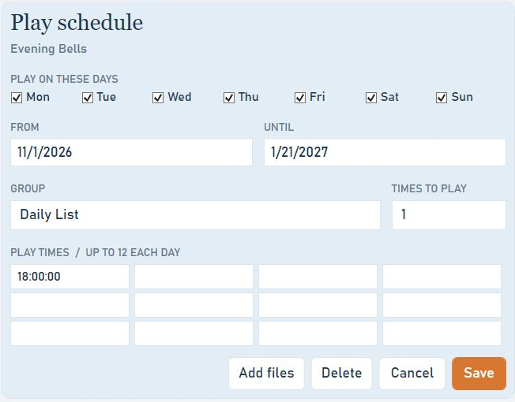
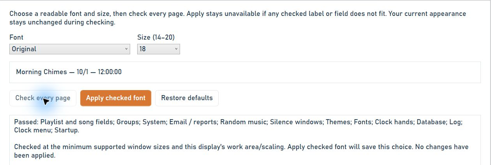

# Start the app

On the PC that will run the app, open **Settings → System → About** and find **System type**. For **64-bit operating system, x64-based processor**, choose **64-bit (win-x64)**. For **32-bit operating system**, choose **32-bit (win-x86)**. The Migration Guide includes more examples.

1. Choose the matching **USB New Install** ZIP. If you have **Package Setup**, run it on the PC to save that ZIP first. In File Explorer, right-click the ZIP and choose **Extract All**. Extract it to a new USB drive or writable PC folder, keeping `CarillonBells.exe` beside `databases` and `Music`.
2. Check the PC date and time and select the intended Windows speakers or amplifier. Set a low volume if you are testing.
3. Open `CarillonBells.exe` where you extracted it. The included database opens with basic time-marking chimes already scheduled. Clear **Schedule enabled** while you set up and test.

**Upgrading from 7.2.4 or 8.1?** Close the old program. Use the matching **USB Upgrade** ZIP on the existing USB. Follow the **Database Migration Guide** in **Documentation**, then run the new executable from the USB to use your database and music.

**Returning to 7.2.4?** Close **Carillon.exe** and **CarillonBells.exe**. Open **CarillonMigration.exe** from the USB Upgrade package, select **Restore 7.2.4…**, and follow the Database Migration Guide.

Start the app from the USB to use its database and music, even if Windows assigns a different drive letter. Close the app before unplugging the USB or copying its installation folder to another drive.

# Add music and test playback

1. Select a supplied chime in **Songs**, or copy your own MP3 or WAV into the **Music** folder beside the executable.
2. To add your own recording, click **Add files** below **Play schedule**, open the **Music** folder, and select the recording. It appears in **Songs**.
3. Set Windows volume low for the test. If the player shows **Unmute**, click it. Use **System volume** to adjust the level, then select the recording and click **Play**. Listen for sound, then click **Stop**. PLAYER records **Last song played**; selecting another row does not change that record.

**Set the displayed name.** In the sidebar, open **System**, enter an **Organization name**, then click **Save** and **Close**. Leave **Playback logging** checked so you can confirm the test in **Log**.

# Set and verify a play time

1. Select your recording. Under **Play on these days**, check each day on which it may play automatically. Clear the checkboxes for the days it should skip.
2. Set **From** and **Until** so the range includes today. Both dates are included. Hover over a date field to reveal its calendar button, click the button, then select the day. The button also appears with keyboard focus. Set **Group** to **Daily List** to use the song’s own times, and set **Times to play** to `1`.
3. Under **Play times**, enter a time a few minutes ahead of the current PC time and leave the other boxes blank. For example, `18:00:00` means 6:00 p.m. Click **Save**.

## Confirm the first scheduled play

Check **Schedule enabled**. Open **Today's schedule** from the sidebar and look for the recording under **Remaining queue**. The **Next Song** card shows the first item due. Keep the app open and listen at the scheduled time, then check **Log** for the **Played Song** entry.

If the recording is missing from the queue, check today’s weekday box, the dates, the saved time, and **Silence windows**. If the player runs without sound, check the Windows output, mute, and volume. Use **Help** in the sidebar or the **User Guide** for daily operation.

# Adjust readability

For a different font, open **System**, then **Font settings**. Choose a font and size, click **Check every page**, and use **Apply checked font** only when the check passes. The confirmation says the font is applied and saved; no extra Save click is needed. Use **Restore defaults** to return to the original appearance.

The **User Guide** covers seasonal group calendars, annual random-music dates such as **10/1**, the eighteen black clock-hand alternatives, silence rules, and email recipients. The Songs list updates automatically after edits. Use the **×** in its search box to show all songs again.

