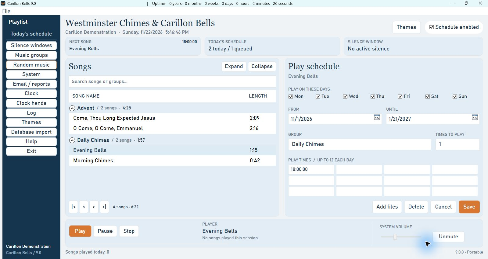

# Start at the website

This guide takes you from the Carillon website to one song playing automatically. It is written for a **new installation on an empty USB drive**. A USB drive is the small removable storage device that plugs into the computer and holds the program, recordings, and schedule together.

If you already use version 7.2.4 or 8.1 on a USB, keep that installation. On the website, use the **Database Migration Guide** for the upgrade instructions instead of following this new-installation guide.

In these instructions, **click** means press the left mouse button once. **Double-click** means press it twice quickly on the same item. **Right-click** means press the right mouse button once to display a menu.

1. Start the program you normally use to visit websites, such as Microsoft Edge or Google Chrome. Double-click its icon if it is on the desktop, or click its icon once if it is on the taskbar at the bottom of the screen.
2. Click the address box at the top of that window. Hold **Ctrl**, press **A**, then release both keys to select the current address. Type **https://carillon-bells.github.io/** and press **Enter** on the keyboard. This is the Westminster Chimes and Carillon Bells website.
3. Click **Downloads** near the top of the website. Find **Choose a software package** on the downloads page.
4. Check that the page offers **version 9.0**. If it still offers only version 8.1, version 9 has not been published there yet; stop here and return when the v9 download is available.

The downloads page separates **New Install**, which supplies a starting schedule and recordings, from **Upgrade**, which uses an existing installation. For this guide you will use **New Install**. Before clicking its download button, check which Windows version your bell computer needs in the next section.

<!-- page break -->

# Check which download fits your computer

The website offers **32-bit** and **64-bit** downloads. These describe Windows on the computer, not the capacity of the USB drive. Check the computer that will actually run the bells, even if you plan to download the files on another computer.

1. Click the Windows **Start** button, the Windows-logo button on the taskbar. Click **Settings**, usually shown with a gear symbol. If you cannot find it, click Start, type **Settings**, then click the Settings result.
2. In Settings, click **System**, then **About**. You may need to scroll down to find About.
3. Find the line labelled **System type**. If it says **64-bit operating system, x64-based processor**, you need the **64-bit** download. If it begins **32-bit operating system**, you need the **32-bit** download, even if the rest of the line mentions x64. If it says **ARM-based processor**, ask for help choosing a suitable version before continuing.
4. Return to the website's Downloads page. Under **New Install**, click the **Package Setup** download for the 32-bit or 64-bit version you just identified. Wait for the browser to finish downloading the file. This installer contains the program, starting schedule, recordings, and guides; it puts them directly onto your USB.

The file's name begins **CarillonBells_9_0_USB_New_Install** and ends **win-x64_Package_Setup.exe** for 64-bit or **win-x86_Package_Setup.exe** for 32-bit. Windows may hide the .exe ending. Download only this installer for these steps. The separate ZIP download is an alternative for people who prefer to copy files themselves; you do not need both.

<!-- page break -->

# Install directly onto the USB

1. Plug an **empty USB drive** into the computer. Hold down the **Windows-logo key**, press **E**, then release both keys. A **File Explorer** window appears; this is the Windows window used to find files and drives.
2. Click **This PC** in its left panel. Find your USB under **Devices and drives**. It may be labelled **USB Drive (E:)**, **Carillon (D:)**, or another name and letter. Note its name and letter so you can select that same drive below. Do not select the computer's **Local Disk (C:)**.
3. Click **Downloads** in File Explorer's left panel. Find the **CarillonBells_9_0_USB_New_Install** installer you downloaded. If you saved it on the desktop, return to the desktop instead. **Double-click that installer**. Its welcome screen appears; click **Continue**.
4. Read the license and click **I accept the license agreement** if you agree. Click the **Install folder** box, press **Ctrl+A**, and type the USB location you identified in step 2. For example, type **E:\V9** to use a folder named V9 on drive E, or **E:\** to use that drive directly. Use your USB's actual letter. Setup creates the V9 folder if needed. You can also use **Browse** to select a folder.
5. Check the Install folder carefully, then click **Install**. Wait for **Install completed**. Click **Verify** to check the installed files in that same folder. Wait for **Verify completed**, then click **Close**. Verify checks an installation after Install; it does not install files itself.
6. In File Explorer, click **This PC**, then double-click that USB drive. If you chose V9, double-click **V9**. You should see **CarillonBells.exe** beside folders named **databases**, **Music**, and **Documentation**. Keep the program and these folders together. No ZIP extraction or second download is needed.

**CarillonBells.exe is the program you will start.** Windows may hide the .exe ending and show only **CarillonBells**. The **databases** folder holds the saved song list and schedule; **Music** holds the actual recordings. **Documentation** contains the guides. The download includes what the program needs to run, so no separate .NET installation is required.

<!-- page break -->

# Double click the program and test the sound

1. Check that Windows shows the correct date and time. Turn down the computer and amplifier volume for your first sound test.
2. In the USB folder from step 6 above, **double-click CarillonBells.exe** or **CarillonBells**. The main Carillon screen appears. At the upper right, if **Schedule enabled** has a check mark, click its box to remove the check mark while you set up. The supplied starting schedule already contains chimes.
3. Click **System** in the left panel. In **Organization name**, click the box, press **Ctrl+A** to select its current text, then type the name you want displayed. Click **Save**, then **Close**. Leave **Playback logging** checked so the app records your test.
4. In the **Songs** list, click a supplied chime once. If the sound control says **Unmute**, click **Unmute**. Then click **Play** at the bottom of the screen. Listen for the chime, then click **Stop**. You can also double-click a song in the list to play it manually.

The player now says **Last song played** followed by the recording's name. Clicking another song selects it for editing; it does not play that song or change the last-played record. If the player moves but you hear nothing, check Windows speakers, mute, volume, and the amplifier connection before continuing.

<!-- page break -->

# Tell one song when to play

Keep **Schedule enabled** unchecked while making this test schedule. You will turn it back on after saving.

1. Click the song you want to test in **Songs**. Its settings appear in **Play schedule** on the right.
2. In **Play on these days**, make sure today's weekday has a check mark. For a song that may play every day, check all seven boxes, **Mon** through **Sun**. Click an empty box to check it; click a checked box to clear it.
3. Set **From**, the first allowed date, and **Until**, the last allowed date, so today's date is included. Point at a date box until its calendar button appears. Click that button, then click a day on the calendar. Use the calendar's arrow buttons to change months if needed. Dates use U.S. month/day/year order; **11/24/2026** means November 24, 2026.
4. Click the **Group** box, press **Ctrl+A**, and type **Daily List**. This lets the song use the play times you enter here. Click **Times to play**, press **Ctrl+A**, and type **1**, meaning one play at each scheduled time.
5. Click the first **Play times** box. Hold **Ctrl**, press **A**, release both keys, then type a time about five minutes ahead of the current time. For example, if it is now **2:10 PM**, enter **2:15 PM**. Use a future time on your computer, rather than copying an example that has already passed.
6. Leave the other eleven time boxes blank for this test. To clear a filled box, click it, press **Ctrl+A**, then press **Delete**. Click **Save** at the bottom of Play schedule.

**Saved play times display in 24-hour format.** You can type **2:15 PM** or **14:15**; after saving, both display as **14:15:00**. Likewise, **8:15 AM** becomes **08:15:00**. **12:00 AM** is midnight (**00:00:00**); **12:00 PM** is noon (**12:00:00**). A blank time box means no play at that position.

# Turn on scheduling and check the result

1. Click **Schedule enabled** at the upper right so it has a check mark.
2. Click **Today's schedule** in the left panel. Find your song and test time under **Remaining queue**. Click **Back to playlist** to return to the main screen.
3. Look at **Next Song**. It shows the next scheduled item, which may be another supplied chime if that is due before your test. Leave the app running and listen when your test time arrives.
4. After the song plays, click **Log** in the left panel. Look for a **Played Song** entry. If your test song was missing from the queue, check its saved time, weekday, From and Until dates, and any active **Silence windows**.

You have now tested both manual playback and scheduled playback. Use the **User Guide**, in the USB's **Documentation** folder, for everyday song editing, silence periods, seasonal music, fonts, and email reports. In File Explorer, double-click the User Guide PDF to read it. You can also click **Help** in the app to read its instructions in your browser.

Email reports need their own setup in **Email / reports**; a new installation does not send them automatically. For regular operation, adjust the test song to the dates and times you actually want, click **Save**, and leave **Schedule enabled** checked. Keep the computer powered on and the USB connected. Close Carillon before unplugging the drive.
