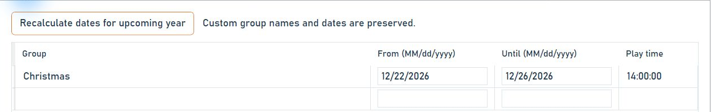
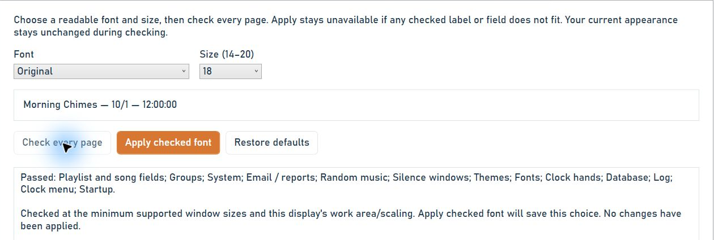

# Start and move the app

Westminster Chimes and Carillon Bells schedules chimes and music on Windows. This guide covers setting up the portable installation, programming bells, controlling playback and silence, and looking after the local database.

## First start

On the PC that will run the app, open **Settings**, then **System**, then **About** and find **System type**. If it reads **64-bit operating system, x64-based processor**, choose the **64-bit** download. If it reads **32-bit operating system**, choose **32-bit**. The filenames use **win-x64** for 64-bit and **win-x86** for 32-bit. The Database Migration Guide gives more examples, including what to do if the processor is described differently. The download includes its .NET runtime, so you do not need to install that separately.

1. Choose **CarillonBells_9_0_USB_New_Install_win-x86.zip** or **CarillonBells_9_0_USB_New_Install_win-x64.zip** to match Windows. If you have **Package Setup** for that package, run it on the PC to save the ZIP to a folder. In File Explorer, use **Extract All** to put the entire ZIP on a new USB drive or in a writable Windows folder. It supplies **CarillonBells.exe**, **data**, **databases**, **Documentation**, **Help**, **logs**, and **Music**.
2. Check the PC date and time, the Windows sound output, and the volume. Open **CarillonBells.exe** where you extracted it. The starter database contains 14 time-marking Westminster chime entries. **Today's schedule** shows the included times, such as 6:00 a.m. and 6:30 a.m.
3. Set the organization name in **System**. Review **Today's schedule** and **Silence windows** before leaving the app unattended. A normal start enables scheduling. For setup or manual playback, clear **Schedule enabled** and use a suitable test output.

For an existing 7.2.4 or 8.1 USB, close the old program and extract the matching **USB Upgrade** ZIP into the existing installation folder beside **databases**. Open **CarillonBells.exe** from the USB. The **Database Migration Guide** in **Documentation** covers the one-time 7.2.4 confirmation and both uses of **CarillonMigration.exe**. It can restore a 7.2.4 database on the existing USB or create a separate v9 installation.

Start **CarillonBells.exe** with the **--evaluation** option to suppress automatic mail during a test. Evaluation mode still plays audio and controls Windows system volume.

## Copy the entire installation

Close the app before copying or unplugging its USB drive. Copy the complete installation, including the executable, database, music, display settings, logs, and documentation. Start the executable inside the copied installation to use that copy's files. Windows can assign a different drive letter. If you move to a PC with different Windows bitness, apply the matching **USB Upgrade** ZIP to the copied installation. Use one running instance per installation.

Place new audio inside the installation before adding it. For example, a playlist path of .\Songs\Evening Bells.mp3 refers to Songs\Evening Bells.mp3 beside the executable. An imported path of C:\Songs\Evening Bells.mp3 resolves to the same Songs subfolder in the current installation. Use a local folder within the installation for each track and random music directory.

# Read the main window

## Status and navigation

The title bar shows Westminster Chimes and Carillon Bells and uptime for the current session in years, months, weeks, days, hours, minutes, and seconds. The main header puts your organization name on its own line, with the current date and time below it. The organization name can wrap if it needs more room. Schedule enabled, near the top right, controls the live queue.

- Next Song shows the scheduled time and title. A repeat marker such as ×3 means the entry will play three times. Longer titles can wrap to two lines. Hover over the title to read it in full.
- Today's Schedule shows the full-day count and the number of events still queued. Open Today's schedule in the sidebar to review the full day and remaining events separately.
- Silence Window shows the reasons currently muting the system or No active silence.
- Songs played today is based on the local log. The footer identifies Portable or Evaluation mode.

## Find controls quickly

The Songs list and its search box are in the center. The Play schedule panel is on the right. The player, progress bar, and Windows volume controls are at the bottom. The sidebar gives you Today's schedule, Silence windows, Music groups, Random music, System, Email / reports, Clock, Clock hands, Log, Themes, Database import, Help, and Exit.

The main window starts maximized. The Songs list, editor, and sidebar can scroll within their own areas when space is limited. Maximize the window when you need more room to review the schedule.

# Add and schedule songs

## Add music and find a song

1. Copy the MP3 or WAV files into a music subfolder within the installation. Use PCM or IEEE-float WAV for uncompressed audio.
2. Click Add files under Play schedule. Select one or more files and confirm the selection. The app reads the duration and adds each recording to the playlist. A new entry has a date range from today through one year ahead. Set its play times when it is ready for scheduled playback.
3. Use Search songs or groups to filter the Songs list. Click the × at the right of a nonempty search box to clear it and see all entries. Expand and Collapse open or close the group headings. Each heading shows the number of entries and their combined length.
4. Select a song to load the editor. The four navigation arrows below Songs move to the first, previous, next, or last record in the current list.

## Enter the schedule

1. In Play schedule, select the weekdays when the song may play.
2. Set From and Until. To choose a date from a calendar, hover over its date field, move onto the calendar button that appears, and click it. Select the day you want. The button also appears when you reach the field with the keyboard and stays visible while the calendar is open. Its space is reserved, so the date text does not move. Both dates are included. Dates use U.S. month, day, and year order. For example, 12/22/2026 means December 22, 2026.
3. Set Group and Times to play. Enter a repeat count of 1 to 5 for each occurrence.
4. Enter up to twelve daily play times. Use 24-hour time such as 08:15:00 or 12-hour time with AM or PM, such as 8:15 AM. Leave an unused time field blank. Enter 00:00:00 to schedule a real midnight play. Identical times entered for the same song produce one occurrence.
5. Click Save and open Today's schedule to confirm the result.

Entering the song editor pauses an enabled schedule until you save, cancel, or leave the edit. Cancel restores the saved record and the preceding scheduling state. If you navigate away with changes, the prompt lets you save, discard the changes, or continue editing. Saved changes reload the list automatically and retain the selected song where it still exists. There is no playlist Refresh button; you do not need to close and reopen the app after an edit or import.

## Remove a playlist entry

Select the song, click Delete under Play schedule, and confirm the named entry. The audio file remains in its folder. If you cannot see an expected entry after a change, clear the search or expand its group. The list selects a neighboring record after a deletion where one is available.

# Run the schedule and player

## Check scheduled playback

Select Schedule enabled to run the queue or clear it to pause scheduling. Today's schedule lists the full day and the remaining queue. The full-day view applies weekly silence exclusions and can also show weekly silence intervals that have yet to end. Use Back to playlist to return.

The player handles queued entries one at a time. When several songs share a time, each eligible song remains a separate occurrence. A busy player can delay an entry in the queue. After detecting a sleep or clock change, the app skips missed times and rebuilds the queue from the current time. An occurrence already recorded for the local date is skipped on restart or re-enable. If a scheduled file failed to open, correct the path and use manual playback to test it before its next occurrence.

## Use manual playback and Windows volume

Select a song and click Play, or double-click its row. You can play a song manually while scheduling is paused. Pause toggles between pause and resume, while Stop ends playback. Under PLAYER, the display reads Last song played followed by the recording that most recently started. Moving the selection in Songs does not change that name. For random playback, it names the actual recording chosen. Before the first play in a session it says No songs played this session. Long names wrap within the player area, clear of System volume. The progress bar indicates playback progress.

System volume and Mute or Unmute act on the Windows default output endpoint. The volume control reflects Windows volume changes. The slider is disabled while the endpoint is muted. Check the selected output in Windows before changing the installation's sound level, especially when a bell amplifier is connected.

# Manage groups and random music

## Work in Administration

Music groups, Random music, Silence windows, System, Email / reports, and Database import open tabs in the Administration window. An enabled schedule pauses while working on those settings. Close Administration to return to the previous schedule state. Opening Themes, Clock hands, or Fonts alone lets scheduling continue. Switching from one of those appearance tabs to an operational settings tab pauses the queue until you close Administration.

Save applies pending settings. Cancel changes reloads the last saved values across the Administration tabs. Closing with actual pending changes prompts you to save, discard the changes, or keep the window open. Simply opening and closing Groups does not ask to save. If you edit a group and then restore all of its original values, that also leaves no group change to save. Palette changes are saved as soon as you choose them or apply custom colors. Clock hand selections use Save.

## Set seasonal group dates and times

Open Music groups to manage seasonal names, From and Until dates, and the group's Play time. The From and Until fields have the same hover and keyboard calendar buttons as the song editor. The grid displays play time in hours, minutes, and seconds. Add group creates a pending row for you to name and complete. Delete group prompts for confirmation and retains the songs. Use First, Previous, Next, and Last to move through the rows. Click Save to apply your changes.

Matching seasonal songs take their dates and first play time from the group. Group synchronization clears their remaining time fields. Daily List retains its individual song schedules. Use Recalculate dates for upcoming year to fill recognized seasonal dates, review the proposed changes, then Save. Custom group dates remain as entered. Christmas uses December 22 through December 26.

## Choose folders for random music

1. Put MP3 files directly inside the folders you plan to use. For example, use Random_songs for the default collection and a folder such as Songs\Advent for an override.
2. Open Random music. Click Browse in the row you want to change and pick a folder within this installation. The picker starts in that row's current folder if available. You can also type a local relative directory, such as .\Random_songs.
3. Set slot 1 for normal playback. To set an annual override, choose a folder and fill both From (month/day) and Until (month/day) in slots 2 through 7. The first matching override in slot order wins. Enter only the month and day, such as 10/1 through 10/31 for October. Do not enter a year. A range may cross New Year, such as 12/22 through 1/6, and repeats automatically every year. Impossible dates and entries that include a year are refused.
4. Click Save. To try the result, play the playlist entry whose title contains Random Music Generator. The app selects an MP3 directly from the applicable folder. Keep playable files at that folder's top level.

The System field labeled Fallback random directory (legacy) is retained for compatibility. Set the active fallback in Random music slot 1.

# Configure silence and system settings

## Set a weekly silence window

Silence windows has twelve reusable rows. In an unused row, enter a short Purpose such as Thursday rehearsal. Keep the description brief enough to fit its field. The app leaves a little spare room and refuses extra typing or a pasted passage that would overflow; it keeps the text already accepted. Existing descriptions are not automatically shortened. Set a Start and End time, choose the weekdays, turn On, and click Save. Leave the row off to keep its values for later. An interval such as Thursday 22:00:00 to 01:00:00 starts Thursday night and continues into Friday. A row with equal start and end times is inactive.

When more than one rule applies, the Silence Window card shows the active reasons. The app manages mute while a reason is active and restores the user's manual mute state when the last reason ends. At the exact end time, weekly schedule generation still excludes a bell at that instant. Leave a small time gap if you need a planned bell immediately after silence.

## Set liturgical and funeral silence

Open System for the organization name, Playback logging, and liturgical and funeral settings. Enable liturgical and funeral silence to apply those dates. Ash Wednesday and All Souls Day run from 02:05 to 23:55 on the configured date. The Holy Thursday through Holy Saturday period runs from 02:05 on the configured Thursday to 23:55 on the configured Saturday.

Use Recalculate Easter / All Souls to propose dates, check the displayed values, and Save. V9 shows one Ash Wednesday date. Its hidden compatibility end date is kept equal to it when you save or recalculate. When opening an older database with a stale end value, the app backs up the database and repairs that value to match the visible date. For funeral silence, enter the complete begin and end dates and times. The end must follow the start. Use Clear funeral dates and Save to remove that interval.

# Review reports and logs

## Configure email and preview a report

In Email / reports, enter the SMTP host, STARTTLS port, username, password or app password, and From address. Enter Alert recipients for alerts and Morning report recipients for the morning report. Test recipient is used only for Send test message and can be blank when you do not use that test; it does not prevent automatic morning reports. Turn on Enable email for automatic delivery in normal mode and Save. Use Show password only when you need to check a value privately.

Preview report saves the current report as a local HTML file. Open the file in your browser to review schedule and playback activity, maintenance, missing music, storage and resource usage, and system health. Send test message uses the test recipient, and Test morning report uses the morning report recipients. Both save pending changes first and ask you to confirm a real message. Use the preview for a local check. If an address is missing or invalid, the error identifies the relevant field. A successful send clears an older email-failure notice; check Log for the latest result.

If the app is already running when 05:00 arrives, the automatic morning report becomes due. Starting at or after 05:00 skips that day's catch-up send. Evaluation mode suppresses automatic reports and silence alerts. Scheduled playback continues in evaluation mode.

## Read recorded activity and maintenance

Open Log for the newest 1,000 entries from logs\CarillonPlayLog.txt. Use Refresh in the Log window to load new events. This is separate from the Songs list, which updates automatically. Schedule pause messages identify the reason, such as song maintenance or Groups maintenance. Long log entries wrap so you can read the full message. Recorded plays appear as Played Song entries. If Playback logging is off, the day's count represents the plays that were recorded while logging was enabled. The app reconstructs the count from the log after a restart.

A running installation writes data\keepalive.txt roughly every 30 seconds. Daily schedule maintenance becomes due at 00:05 while scheduling is enabled. Log trimming becomes due at 00:10 and also runs at startup. The log retains 30 days of readable entries and preserves older lines with unreadable timestamps. These background tasks continue while the Clock and Log windows are open.

# Set the clock and appearance

Open Clock for the live analog display. The face scales when you resize or maximize the window. Choose File, then Close, to return to the playlist. Scheduling continues while the clock is open.

Click Clock hands below Clock in the sidebar. Select a style to see its preview at 10:10 on the clock face. Original uses the classic hands. There are eighteen black alternatives, including Taper, Spade, Breguet, Twin scroll, Lyre, Vienna, and Nouveau. Their slender hands stop short of the minute marks. Smaller selection cards leave room for more choices; click a card to inspect the existing large preview on the right. The original clock face and preview proportions are preserved. Click Save to apply the selected hands to the live clock. Cancel changes discards the preview selection. The saved selection follows the portable copy in data\clock-hands.txt.

Open Themes from the main window or its Administration tab. Choosing a palette immediately applies and saves it. For your own colors, enter six-digit values such as #EFF3F6 for the background and #173650 for the text, then click Apply and save custom colors.

# Choose a readable font

## Check a font before applying it

Open System, then click Font settings. You can also select Fonts in Administration. Save or cancel any other edits first.

1. Choose Original, Bahnschrift, Segoe UI, Arial, Tahoma, Verdana, or Calibri. Original keeps the original mix of body and heading fonts.
2. Choose a size from 14 through 20. Size 18 is the original base size. The sample shows the candidate without changing the rest of the app.
3. Click Check every page. The app checks current labels and field values at the smallest supported window size as well as this display's available space. It also checks the date calendars, schedule view, log, clock menu, and startup screen.
4. If the check passes, click Apply checked font. A confirmation names the font and size and says they are applied and saved. You do not need to click Save again.
5. If a check fails, read the named field or label, then try a smaller size or a narrower font. The app refuses the whole choice when something would be cut off. Changing the font or size requires another check.

A size in the list is a choice to test, not a promise that every font will fit at that size. Different fonts use different widths, and longer field values can change the maximum that fits. The app does not accept scrolling inside an input field as a substitute for fitting its text.

## Restore or move your font choice

Restore defaults returns to the original appearance. The saved font choice travels with the portable installation. It is checked again when the app starts and when the main window changes display scaling. If a saved custom choice no longer fits, the app restores Original and explains why. Review the Fonts page on the computer that will run the bells.

# Open Help and close the program

Help opens the local HTML guide in your default browser. The single-executable release carries this guide inside the executable, and the new USB package also supplies an HTML copy in **Help**. Its contents are available offline. The optional GTranslate widget requires internet access. Exit, File then Exit, and the window close button follow the same shutdown procedure and check for pending edits.

# Import and recover a database

## Inspect and import a copy

Database import is for bringing a separate carillon.db into an existing v9 installation. It replaces that installation's local playlist and settings with the imported copy; it does not add a second library or copy recordings. You do not need it merely to open your normal installation or complete an in-place upgrade. Make a backup and use the Migration Guide if you are unsure which route you need.

1. Close any instance of the app using the source file. Start the separate v9 installation, open Database import, and check the displayed current local database path.
2. Choose Analyze source database and select the source carillon.db. Review SQLite integrity and the random-directory schema in the scrollable report. The report includes table, view, index, and trigger definitions. Save report exports the report currently displayed as a text file.
3. Click Choose and import a database copy and select the source. The app copies and validates it, backs up the existing local database in databases\backup, then installs the compatible copy. The source stays read-only.
4. Review the import result and note the ZIP path. Close Administration to load the imported playlist in the main window. Verify songs, group times, random music folders, silence, and email settings before leaving it unattended.
5. Copy any missing music into the new installation with the folder layout expected by its playlist. The imported database carries the references to music. Transfer the audio files separately and test a known song from every relevant music folder.

## Restore an earlier local database

Record the backup ZIP path from the import report. Close the app and preserve the current local database under another name or in a separate backup before restoring. Extract carillon.db from the chosen ZIP into the installation's databases folder. Keep the ZIP and any reports secured with other copies of your settings. Restart the app and review the playlist, settings, and next play.

## Return to version 7.2.4

Close **Carillon.exe** and **CarillonBells.exe**. Open **CarillonMigration.exe** from the matching Windows release and select **Restore 7.2.4…** to begin. Choose the USB installation and its dated pre-upgrade ZIP, then review the restore. **Back Up and Restore** saves your current v9 database separately before restoring the original. Open **Carillon.exe** from the USB after the restore and check the schedule. See the **Database Migration Guide** for the full procedure.

# Troubleshoot common problems

- No sound. Check the Silence Window card and the Windows output device, mute setting, and volume. Try a known local song with Play. If the player reports a missing file, compare the displayed full path with the actual folder and filename.
- Random music uses an unexpected folder. Check the current date against slots 2 through 7 in order. Review slot 1 for dates outside those overrides. Check that the selected folder contains MP3s at its top level.
- A song is missing from today's schedule. Confirm its weekday, date range, and time. If it is seasonal, look under Music groups for the governing dates and first play time. Check weekly silence and use the remaining-queue list to see what has already passed or dispatched.
- Startup reports a lock or storage problem. Close any other instance of the app using that copy. Reconnect the USB drive if needed, check write access, and run the executable from the extracted portable folder.
- A report fails to send. Check the configured recipients, SMTP host, STARTTLS settings, and credentials. Review Log for the error. Confirm whether the app is in Evaluation mode if you were expecting automatic mail.
- A font is refused. Read the field named by Check every page, then try a smaller size or a narrower font. Restore defaults returns to Original. Do not expect every listed size to fit every computer or set of data.
- The visible schedule seems stale. Close Administration, complete any pending song edits, and check Schedule enabled. Confirm the Windows date and time, then inspect Today's schedule again.

Before an unattended session, confirm the expected next song, active silence reasons, output device and level, and the most recent recorded play. Keep a copy of the complete working installation or a verified recovery ZIP where it can be accessed if the portable drive fails.
