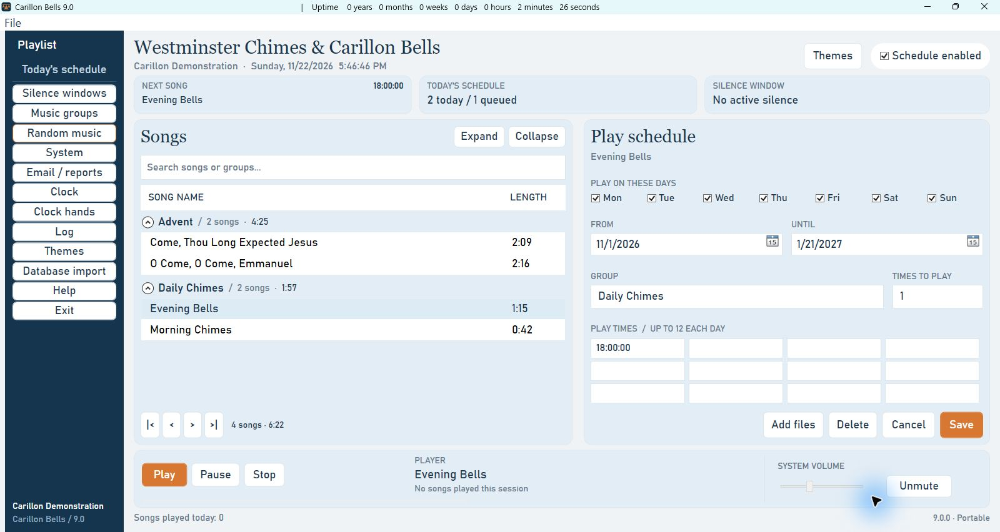
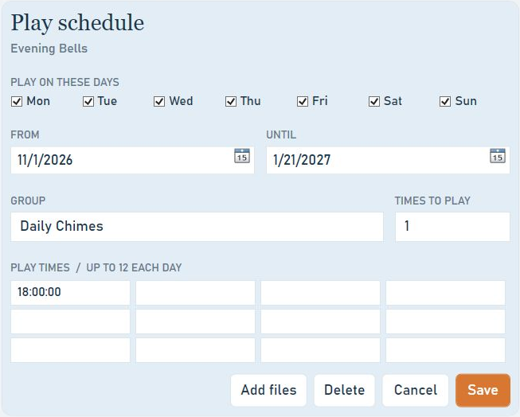
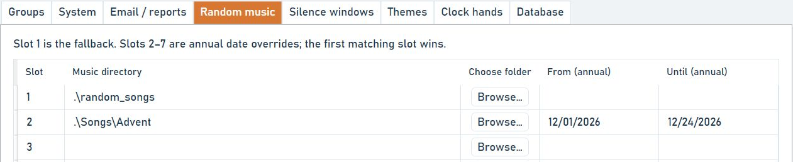
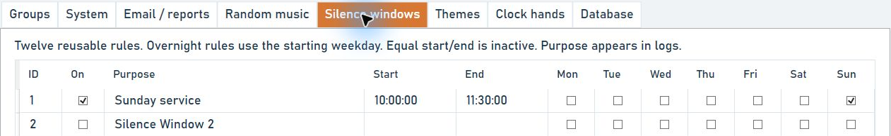
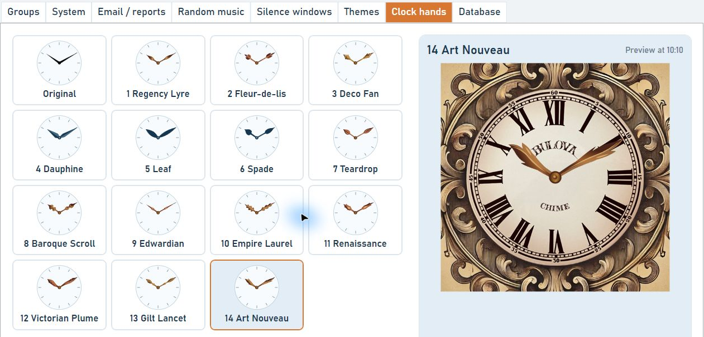

# Open your installed program

This guide helps you use Westminster Chimes and Carillon Bells 9.0 after installation, from choosing recordings and setting their schedules to arranging quiet periods, checking reports, and adjusting the display. If you are setting up a new installation, begin with the **Quick Start Guide**; if you are moving an existing version 7.2.4 or 8.1 installation to version 9, use the **Database Migration Guide** for the download, unpacking, backup, and upgrade instructions.

Once you have checked the schedule and settings, the program is designed to run continuously without routine attention, managing playback, silence periods, and enabled reports for you. The computer must remain powered on and the USB connected, because a power failure, disconnected drive, or other system problem can interrupt operation.

## Open the correct copy

A USB drive or computer may hold more than one copy of the bell program, each with its own database and recordings. Before you review a schedule or make changes, identify the installation you intend to use so that you are working with the correct bell system.

1. Plug in the USB that holds your installation, then click **File Explorer**, the folder icon on the Windows taskbar, and choose **This PC** to find the drive. Double-click the USB and, if you keep the installation in a folder such as V9, double-click that folder as well.

2. Find **CarillonBells.exe** alongside the databases folder and your music folders, then double-click it to start the program. Windows may hide the .exe ending and display the name as **CarillonBells**, so check that you are starting the installed version rather than an older program or a copy still inside a downloaded ZIP.

3. Check the organization name, today's date, and **Next Song** to make sure you have started the intended installation. A normal startup enables scheduling and prepares the songs to play at their scheduled times; if you want to review settings or test recordings without scheduled playback, clear **Schedule enabled** first.

The program automatically opens the database stored with its own installation, so you do not need **Database import** for normal startup. Starting the program from another installation folder uses that folder's database and music instead; the later section on importing and recovering a database explains when you would use the import feature.

## Keep the installation together

Keep the program and its databases, music, data, Documentation, and **Help** folders together in the same installation folder. The database stores the song list and schedule, while the music folders contain the recordings themselves, so moving only the program or only the database does not move the complete bell system.

To move your installation, close the program and copy the complete installation folder to another writable drive, keeping the original drive as a backup. Once the copy is complete, double-click **CarillonBells.exe** in the copied folder to start that installation.

Windows may assign the new drive a different letter, which is normal. If you are also moving to another computer, follow the **Database Migration Guide** to check which Windows edition the computer supports before starting the program there. The 32-bit edition can also run on a supported 64-bit Windows PC, while the 64-bit edition requires 64-bit Windows on an x64 PC.

Before adding a recording to the song list, place it in the Music folder or create another folder within the installation with a name that helps you organize your collection. For example, Music\Evening Bells.mp3 identifies the Evening Bells recording inside the Music folder beside the program. If an upgraded installation already uses folders named **Songs** or Random_songs, keep those names and their contents in place.

# Read the main window

The main window is your daily view of the bell system, bringing the music list, schedule, playback controls, and current status together. A quick review here helps you see what is due to play, whether a quiet period is active, and where to go when you need to make a change.

## Status and navigation

After starting the program, use the header and status cards to confirm that the installation is showing the information you expect. They provide a useful first check before you leave the system running on its own, or whenever the bells appear to be behaving differently from the schedule you intended.

The title bar identifies Westminster Chimes and Carillon Bells and shows how long the current session has been running, from years down to seconds. Below it, the main header gives your organization name its own line, allowing it to wrap when necessary, with the current date and time underneath.

Near the top right, **Schedule enabled** controls scheduled playback. The program temporarily pauses an enabled schedule while you perform operational maintenance, then restores the state it had before you began: a previously enabled schedule resumes, while one you had already paused remains paused.

- **Next Song** shows the scheduled time and title of the next recording, with a marker such as ×3 when it is set to repeat three times. Longer titles wrap onto a second line, and you can point at the title to read its full text.

- **Today's Schedule** shows how many events are scheduled for the full day and how many remain in the queue. To review the full-day list and the remaining events separately, click **Today's schedule** in the sidebar.

- **Silence Window** shows the reasons the system is currently muted, or **No active silence** when no silence rule applies, so you can see at a glance whether a quiet period is affecting playback.

- **Songs played today** counts the plays recorded in the local log, while the footer identifies whether the program is running in **Portable** or **Evaluation** mode.

## Find controls quickly

The **Songs** list and its search box occupy the center of the window, with **Play schedule** on the right and the player, progress bar, and Windows volume controls along the bottom. The sidebar gives you access to **Today's schedule**, **Silence windows**, **Music groups**, **Random music**, **System**, **Email / reports**, **Clock**, **Clock hands**, **Log**, **Themes**, **Database import**, **Help**, and **Exit**.

The main window starts maximized to provide room for the music list and schedule editor, and the list, editor, and sidebar each have their own scroll area when the available space is limited.

# Add and schedule songs

A recording needs a playlist entry and a schedule before the program can play it automatically. The playlist identifies the music you want to use, while the schedule determines the dates, weekdays, and times when each entry is eligible to play; the following procedures take you from adding a recording to checking its scheduled appearance.

## Add music and find a song

Adding music creates an entry that points to an audio file already stored in your installation. Keeping the recordings within that installation lets them travel with the USB, and organizing them into meaningful folders makes a larger collection easier to maintain.

1. Copy your MP3 or WAV files into Music, or another music folder you have created within the installation, before adding them to the list. WAV recordings must use PCM or IEEE-float audio.

2. Click **Add files** beneath **Play schedule**, select one or more recordings, and confirm your selection. The program reads each recording's length and adds it to the playlist with a date range from today through one year ahead, ready for you to enter its play times.

3. Use **Search songs or groups** to find an entry by song or group name, and click the × at the right of the search box when you want to clear the search and see all entries again. **Expand** and **Collapse** open or close the group headings, which show each group's number of entries and their combined playing time.

4. Select a song to display its settings in **Play schedule**, where you can use the four navigation arrows to move to the first, previous, next, or last record in the current list.

5. New songs are assigned to **Daily List** by default, so expand that group to find a recording you have just added. Select it there to set its dates and play times, or choose a different **Group** when the recording belongs to a seasonal collection.

## Enter the schedule

Use the song editor to turn a playlist entry into a regular appointment for the bells, choosing its active date range, weekdays, play times, and repeat count. Decide when you want the recording to be heard before filling in these fields, and review the seasonal-group instructions if several songs should share the same dates and first play time.

1. Select the song you want to schedule, then use the weekday checkboxes in **Play schedule** to choose the days on which it may play.

2. Enter the **From** and **Until** dates, remembering that both dates are included in the schedule. To use a calendar, point at the date field, move onto the calendar button that appears, and click it to choose a day; the button also appears when you reach the field with the keyboard and remains visible while the calendar is open. The date text stays in place, and dates follow U.S. month/day/year order, so 12/22/2026 means December 22, 2026.

3. Choose the **Group** and set **Times to play** to a number from 1 through 5, according to how many times the recording should repeat at each scheduled occurrence.

4. Enter up to twelve daily play times, leaving unused boxes blank. You may type a 24-hour time such as 18:15 or an AM/PM time such as 6:15 PM, and both are saved and displayed as 18:15:00; similarly, 8:15 AM becomes 08:15:00. Remember that 12:00 AM is midnight (00:00:00), while 12:00 PM is noon (12:00:00), and that entering the same time twice for one song produces only one occurrence.

5. Click **Save** when you have finished, then open **Today's schedule** to confirm that the song appears at the expected time.

When you enter the song editor, the program pauses an enabled schedule until you save, cancel, or leave the edit. **Cancel** restores the saved record and the previous scheduling state, while navigating away with unsaved changes gives you the choice of saving, discarding those changes, or continuing to edit.

After an edit or import, the music list updates automatically and keeps the selected song whenever it is still present. There is no manual **Refresh** button for this list, and you do not need to close and reopen the program to see your changes.

## Remove a playlist entry

When a recording is no longer part of your bell program, you can remove its playlist entry without erasing the audio file. This is useful when retiring an old selection or reorganizing the schedule, because the recording remains available if you decide to add it again later.

To remove an entry, select the song, click **Delete** beneath **Play schedule**, and confirm the named recording. This removes it from the playlist while leaving the audio file in its folder, and the list selects a neighboring entry when one is available. If an expected song seems to be missing after another change, clear the search and expand its group before checking the entries again.

# Run the schedule and player

The program can play music automatically at scheduled times or let you start a recording yourself. Automatic playback is intended for normal unattended operation, while manual playback is useful for checking a new recording, confirming the sound level, or testing the connection to your audio system.

## Check scheduled playback

During automatic operation, eligible recordings enter a queue, or waiting list, as their scheduled times arrive. Reviewing **Today's schedule** after an edit helps you confirm what is planned for the day and what still remains to play before you leave the system unattended.

Select **Schedule enabled** to run scheduled playback, or clear it when you want to pause the schedule. **Today's schedule** lets you review the full day and the remaining queue, with songs falling within weekly silence windows excluded from the full-day schedule; it can also show weekly silence intervals that have not yet ended. When you have finished reviewing the list, click **Back to playlist** to return.

The player handles scheduled entries one at a time, so a recording already playing can delay another entry in the queue. **Songs** sharing a scheduled time remain separate occurrences and play in the order shown by the generated schedule, rather than all starting together.

If the computer sleeps or its clock changes, the program skips missed play times and rebuilds the queue from the current time. It also avoids replaying an occurrence already recorded for that local date after a restart or when scheduling is re-enabled. If a scheduled song fails to open, correct its file path and test it with manual playback before its next scheduled occurrence.

## Use manual playback and Windows volume

Manual playback lets you hear a selected recording without waiting for its scheduled time. It uses the computer's actual audio output, so check the connected amplifier or speakers and the intended sound level before starting a test, particularly when the bells can be heard outside the building.

To test a recording, select it and click **Play**, or double-click its row in the music list; manual playback is available even while scheduling is paused. **Pause** switches between pausing and resuming the recording, **Stop** ends playback, and the progress bar shows how far the recording has played.

Under **PLAYER**, **Last song played** identifies the recording that most recently started, so selecting a different song in the list does not change that display. For random playback it shows the actual recording chosen, while **No songs played this session** appears before the first play. Long names wrap within the player area to keep them clear of **System volume**.

**System volume** and **Mute** or **Unmute** control the Windows default audio output and stay in step with changes made in Windows, so adjusting the volume in either place updates the other. While that output is muted, the slider is disabled and appears grayed out; check the selected Windows output before changing the sound level, especially when the computer is connected to a bell amplifier.

# Manage groups and random music

Seasonal groups and random music offer two ways to manage collections of recordings. A group gives named songs a shared seasonal timetable, while random music chooses an MP3 from a folder that applies to the current date; choose the approach that suits whether you want particular songs or a changing selection.

## Work in Administration

The **Administration** window brings related settings together in tabs, allowing you to work on the installation without losing your place in the main music list. Before changing operational settings, it helps to understand when the schedule pauses, how changes are saved, and what happens when you close the window.

**Music groups**, **Random music**, **Silence windows**, **System**, **Email / reports**, and **Database import** open their settings in the **Administration** window and pause an enabled schedule while you work. Closing **Administration** restores the previous schedule state. **Themes**, **Clock hands**, and **Fonts** can be opened on their own without pausing playback, but switching from an appearance tab to operational settings pauses the queue until **Administration** closes.

Click **Save** to apply pending settings, or **Cancel changes** to reload the last saved values across the **Administration** tabs. If you close the window with actual changes pending, the program asks whether you want to save them, discard them, or keep editing; simply opening and closing **Groups**, or changing a value and then restoring it, leaves nothing to save.

Appearance settings have their own save behavior: choosing a palette or applying custom colors saves the choice immediately, while a clock-hand selection is applied with **Save**. **Font settings** confirms when a checked font has been applied and saved.

## Set seasonal group dates and times

A seasonal group lets related songs follow one date range and first play time, so you can prepare Christmas, Easter, or another season without editing every recording individually. Use this shared timetable for songs that belong together, while keeping individually scheduled selections in **Daily List**.

Click **Music groups** to manage seasonal group names, their **From** and **Until** dates, and the group's **Play time**. You can enter a time in either 24-hour or AM/PM form, with saved values displayed in hours, minutes, and seconds. To choose a date from a calendar, point at its field and click the calendar button that appears, or reach the field with the keyboard; when you save, date and time changes apply to the matching songs in that seasonal group.

Use **Add group** to create a row that you can name and complete, or **Delete group** to remove a group after confirming your choice; deleting the group retains its songs. **First**, **Previous**, **Next**, and **Last** move through the rows, and **Save** applies the changes when you have finished.

**Songs** that match a seasonal group use the group’s start date, end date, and first play time, with any additional song play times cleared during synchronization, while songs in **Daily List** keep their individual schedules.

To prepare for the coming year, click **Recalculate dates for upcoming year**, review the proposed changes, and click **Save** when you are satisfied. This updates recognized seasonal dates while preserving any custom group dates you have entered, with Christmas set to run from December 22 through December 26.

## Choose folders for random music

Random music provides variety by choosing a recording from a folder rather than always playing one named song. The **Random Music Generator** playlist entry uses your regular collection for most dates and can switch to seasonal folders during annual date ranges, making it useful when you want the selection to change while keeping a predictable schedule.

1. Place your MP3 files directly in the folders you want to use, rather than in subfolders within them. For example, you might keep your regular collection in Random_songs and your Advent collection in **Songs**\Advent, so the program can choose music from the appropriate folder.

2. Open **Random music** and click **Browse** beside the row you want to change, then select a folder within your installation. The folder picker begins in that row’s current folder when it is available, or you can type a relative folder path such as .\Random_songs.

3. Use slot 1 for your regular music collection and slots 2 through 7 for collections that play during particular times of the year. For each seasonal collection, choose its folder and enter both a **From** and an **Until** date using only the month and day—for example, 10/1 through 10/31 for October. These dates repeat automatically every year and may extend across New Year, as in 12/22 through 1/6. If more than one seasonal date range applies, the program uses the first matching slot, starting with slot 2; otherwise, it uses slot 1. Entries containing a year or an impossible date will not be accepted.

4. Click **Save**, then test your selection by playing the playlist entry whose title contains **Random Music Generator**. The program chooses an MP3 from the folder that applies to the current date, so be sure the playable files are directly inside that folder.

The **Fallback random directory (legacy)** field in **System** remains for compatibility with older installations; use slot 1 in **Random music** to choose the default folder used by the current program.

# Configure silence and system settings

Silence settings let you keep the bells quiet for services, rehearsals, solemn observances, and other occasions without repeatedly changing individual song schedules. Weekly windows handle recurring commitments, while the date-based settings in **System** cover liturgical observances and funeral periods.

## Set a weekly silence window

A weekly silence window repeats on the weekdays you choose, making it suitable for a regular service or rehearsal. Decide which days and times should remain quiet, including whether the interval crosses midnight, before completing a row.

**Silence windows** provides twelve reusable rows for regular quiet periods. Begin with an unused row and enter a short **Purpose**, such as Thursday rehearsal, that will help you recognize the rule in the display and log. The program leaves a little spare room in this field and refuses typing or pasted text that would overflow it, while keeping the text already accepted and leaving existing descriptions unchanged.

Set the **Start** and **End** times, choose the weekdays, select **On**, and click **Save** to activate the rule. You can enter 10:00 AM and 11:30 AM, for example, and the saved values appear as 10:00:00 and 11:30:00. Clearing **On** retains the row's values for later use, while entering equal start and end times makes the rule inactive.

For a quiet period that crosses midnight, select the weekday on which it begins: Thursday from 22:00:00 to 01:00:00 continues into Friday morning. This lets one row describe the whole overnight period without a second rule for the following day.

When silence rules overlap, **Silence Window** shows the active reasons and the program keeps the system muted until the last reason ends, then restores your previous manual mute setting. Weekly schedule generation also excludes a song set for the exact end of a silence window, so leave a small gap after that end time if you need a recording to play immediately afterward.

## Set liturgical and funeral silence

Some quiet periods follow calendar dates rather than a weekly routine. The liturgical settings allow the system to observe the specified church dates, while funeral silence provides a beginning and ending date and time for a particular occasion; review those dates before enabling the periods you intend to use.

Open **System** to set the organization name, **Playback logging**, and liturgical or funeral silence, then select **Enable liturgical and funeral silence** if you want those periods to apply. Ash Wednesday and All Souls Day remain quiet from 02:05 to 23:55 on their configured dates, while the Holy Thursday through Holy Saturday period runs from 02:05 on the configured Thursday until 23:55 on the configured Saturday.

Click **Recalculate Easter / All Souls** to propose the seasonal dates, review the displayed values, and click **Save** when they are correct. Version 9 shows one Ash Wednesday date and keeps its hidden compatibility end date synchronized when you save or recalculate; if an older database contains a stale end value, the program first backs up the database and then repairs that value to match the visible date.

For funeral silence, enter the complete beginning and ending dates and times, making sure the end follows the start. When you no longer need the interval, click **Clear funeral dates** and then **Save** to remove it.

# Review reports and logs

Reports and logs help you follow the bell system's operation even when you are not beside the computer. Email can deliver alerts and a morning summary to designated people, while the local log provides recorded playback and maintenance details that you can consult when checking an event or investigating a problem.

## Configure email and preview a report

Email notifications let the program send alerts and reports through an account you provide, helping the people responsible for the bells stay informed. An account reserved for your organization can keep this correspondence separate from personal mail, although a separate account is not required by the program.

Before filling in the settings, have your mail provider's sending-server details and sign-in information ready, including an app password if your provider requires one. The account must allow SMTP sending, and the bell computer needs an internet connection to deliver messages; you can still preview a report locally without sending email.

In **Email / reports**, enter your mail provider's **SMTP host**, **STARTTLS port**, username, password or app password, and **From address**. Use **Alert recipients** for alerts and **Morning report recipients** for the daily report, while **Test recipient** is used only by **Send test message** and may be left blank when you do not intend to send a test.

To allow automatic delivery in normal operation, select **Enable email** and click **Save**. Use **Show password** only when you need to check the value privately; leaving **Test recipient** blank does not prevent the automatic morning report.

Click **Preview report** to save the current report as a local HTML file, then double-click the file to review it in your browser. The report brings together schedule and playback activity, maintenance, missing music, storage and resource usage, and system health, allowing you to check the information without sending a message.

When you are ready to test delivery, **Send test message** uses **Test recipient**, while **Test morning report** uses **Morning report recipients**. Both save pending changes first and ask you to confirm that a real message may be sent. If an address is missing or invalid, the error names the relevant field; after a successful send, an older email-failure notice clears, and **Log** shows the latest result.

The automatic morning report becomes due at 05:00 when the program is already running, whereas starting at or after 05:00 skips that day's catch-up send. **Evaluation** mode still allows scheduled playback but suppresses automatic reports and silence alerts.

## Read recorded activity and maintenance

The log is the program's local record of playback and maintenance activity, giving you a place to check what was recorded around a particular time. It is useful when a song appears to have been missed, a schedule was paused, or a report could not be sent, and you do not need to configure email to read it.

Open **Log** to read the newest 1,000 entries from logs\CarillonPlayLog.txt, and use **Refresh** within that window when you want to load newly recorded events. This button updates the log only; the music list refreshes automatically. Long entries wrap for easier reading, and schedule-pause messages identify the reason, such as song maintenance or **Groups** maintenance.

Recorded playback appears as **Played Song** entries, which the program uses to reconstruct the day's count after a restart. If **Playback logging** is turned off for part of the day, the count reflects only the plays recorded while logging was enabled.

While running, the program asks Windows to stay awake and writes to data\keepalive.txt about every 30 seconds to help keep the installation drive active. Leave the computer powered on and the USB connected for unattended playback, since these measures cannot prevent a power loss or a disconnected drive. Schedule and log housekeeping continues while the **Clock** and **Log** windows are open, and the log normally retains 30 days of readable entries.

# Set the clock and appearance

The clock display and appearance settings let you adapt the program to the way it is viewed in your installation. You can show the analog clock, choose a hand style, or change the color palette while retaining the bell system's existing schedules.

Click **Clock** to display the live analog clock, whose face scales as you resize or maximize the window. Scheduling continues while the clock is open, and you can return to the playlist by choosing **File**, then **Close**, in the clock window.

The hand gallery lets you compare styles against the original clock face before choosing one for the live display. Use the large preview to judge readability, especially if the clock will be viewed from a distance.

Click **Clock hands** below **Clock** in the sidebar, then select a style to see it in the large preview at 10:10. **Original** keeps the classic hands, while eighteen slender black alternatives include Taper, Spade, Breguet, Twin scroll, Lyre, Vienna, and Nouveau. The alternatives use the original hands as their length guide, with the minute hand reaching the minute marks and the hour hand extending slightly past the bottom of the Roman numerals.

The compact selection cards make room for more choices without changing the original clock face or the large preview's proportions. When you find a style you like, click **Save** to apply it to the live clock, or **Cancel changes** to discard the preview selection. Your saved choice travels with the portable installation in data\clock-hands.txt.

A color theme changes the appearance of the program's windows, allowing you to choose a palette that is comfortable for the display and lighting where it will be used. Ready-made palettes are available, or you can supply your own background and text colors.

Open **Themes** from the main window or its **Administration** tab and choose a palette to apply and save it immediately. To create your own color combination, enter six-digit values such as #EFF3F6 for the background and #173650 for the text, then click **Apply and save custom colors**.

# Choose a readable font

Text that is comfortable at one desk may be difficult to read on another screen or from farther away. Font settings lets you choose a typeface and size for the program, with a fit check that helps keep labels and field values readable before the new choice is applied.

## Check a font before applying it

Before changing the font, save or cancel any other edits, then open **System** and click **Font settings**. You can also reach the same page by selecting **Fonts** in **Administration**.

1. Choose a typeface from **Original**, **Bahnschrift**, **Segoe UI**, **Arial**, **Tahoma**, **Verdana**, or **Calibri**, using **Original** when you want to keep the program's original combination of body and heading fonts.

2. Select a size from 14 through 20, with 18 representing the original base size. The sample lets you judge the candidate font and size without changing the rest of the program.

3. Click **Check every page** to test the current labels and field values at the smallest supported window size and against the space available on your display. The check also covers date calendars, the schedule view, log, clock menu, and startup screen.

4. If the check passes, click **Apply checked font** and look for the confirmation naming the font and size that have been applied and saved. There is no need to click **Save** again for this choice.

5. If a check fails, use the named field or label to identify the problem, then try a smaller size or a narrower font and run **Check every page** again. The program refuses the whole choice if anything would be cut off, and changing either the font or its size requires a fresh check.

The sizes in the list are choices to test, because fonts vary in width and longer field values can reduce the size that fits. Text must fit within its field without relying on horizontal scrolling, which helps keep the completed screen readable and professional.

## Restore or move your font choice

Your preferred font may need another look when the USB is moved to a computer with a different display or scaling setting. The saved choice travels with the installation, and the default appearance gives you a familiar starting point if you want to choose again.

Click **Restore defaults** whenever you want to return to the original appearance. A saved font choice travels with the portable installation and is checked again at startup and when the main window's display scaling changes; if it no longer fits, the program restores **Original** and explains why. Review the **Fonts** page on the computer that will actually run the bells to confirm the choice there.

# Open Help and close the program

The local Help guide is available when you need a reminder while using the program, including when the computer is offline. When your work is finished, the normal exit controls give you a chance to resolve pending edits before the program closes.

Click **Help** to read the local HTML guide in your default browser. The single-executable edition includes the guide inside the program, and the New Install USB package also provides an HTML copy in **Help**, so the instructions are available offline; only the optional GTranslate translation widget needs internet access.

When you have finished using the program, choose **Exit**, use **File** then **Exit**, or click the window's close button. All three follow the same shutdown procedure and check for pending edits before the program closes.

# Import and recover a database

The database contains the playlist and operating settings, so importing or restoring one changes the information used by the current installation. Import brings in a separate database copy, whereas restoration returns to an earlier saved state; these are maintenance procedures for a deliberate transfer or recovery, not steps required for everyday startup.

## Inspect and import a copy

Use **Database import** when you need to bring a separate carillon.db into an existing version 9 installation. Importing replaces that installation's playlist and settings with the imported copy, rather than adding a second library, and recordings must be copied separately. You do not need this feature for normal startup or an in-place upgrade, so make a backup and consult the **Database Migration Guide** first if you are unsure which procedure applies.

1. **Close** any program instance that is using the source database, then start the separate version 9 installation where you intend to import the copy. Open **Database import** and check the displayed local database path before proceeding.

2. Click **Analyze source database**, choose the source carillon.db, and review the scrollable report for SQLite integrity and the random-directory structure. The report also lists the database's tables, views, indexes, and triggers; use **Save report** if you want to retain the displayed results as a text file.

3. Click **Choose and import a database copy** and select the source database. The program copies and validates it, backs up the destination's existing database in databases\backup, and installs the compatible copy while leaving the source database read-only.

4. Review the import result and note the backup ZIP path, then close **Administration** to load the imported playlist into the main window. Before leaving the system unattended, check the songs, group times, random-music folders, silence periods, and email settings.

5. Copy any missing recordings into the destination installation, preserving the folder layout expected by the imported playlist. The database contains references to the music rather than the recordings themselves, so transfer the audio files separately and test a known song from each relevant music folder.

## Restore an earlier local database

Restoring a backup can help you recover a known set of settings after an unwanted change or import. Choose the backup carefully, because returning to its saved state can replace work completed since it was made, and preserve the current database before you begin.

Before restoring a database, note the backup ZIP path shown in the import report, close the program, and preserve the current local database under another name or in a separate backup. Extract carillon.db from the chosen ZIP into the installation's databases folder, then restart the program and check the playlist, settings, and next scheduled song. Keep the ZIP and any reports securely with your other backup copies.

## Return to an older version

You may want to resume an earlier version while you check a new installation or investigate an operating problem. Keeping the old executable is only part of that preparation: the program and database must be suitable for the version you are returning to, so use the recovery method that matches your upgrade.

Follow the **Database Migration Guide** when returning to version 7.2.4 or 8.1, because the recovery procedure depends on the version and upgrade method you used. Restoring an earlier backup can replace changes made since that backup; the older program names and Migration Assistant procedures described in that guide are recovery tools, rather than programs you need for everyday version 9 operation.

# Troubleshoot common problems

When something does not behave as expected, begin with the symptom you can observe and work through the relevant checks below. The current schedule, silence status, file location, and log often help you narrow down the cause before making further changes to an otherwise working installation.

- **No sound.** Begin with **Silence Window** and the Windows output device, mute setting, and volume, then use **Play** to test a known local recording. If the player reports a missing file, compare the full path in the message with the recording's actual folder and filename.

- **Random music** uses an unexpected folder. Compare today's date with the ranges in slots 2 through 7, starting with slot 2, and check slot 1 for dates outside those ranges. Make sure the selected folder contains playable MP3 files directly inside it, rather than in subfolders.

- **A song is missing from today's schedule.** Check the song's weekdays, date range, and play times, then look under **Music groups** if its dates and first play time come from a seasonal group. Review any weekly silence windows and the remaining queue to distinguish a missing entry from one whose time has already passed or which has already been dispatched.

- **Startup reports a lock or storage problem.** **Close** any other program instance using the same installation, then check that the USB is connected and its folder allows changes. If you reconnect the drive, start the program from the installed folder rather than from the downloaded ZIP.

- **A report fails to send.** Check the recipients, **SMTP host**, **STARTTLS port**, and sign-in details in **Email / reports**, then open **Log** for the specific error. If you expected an automatic message, also check whether the program is running in **Evaluation** mode, which suppresses automatic delivery.

- **A font is refused.** Read the field or label named by **Check every page**, try a smaller size or a narrower font, and check again before applying it. **Restore defaults** returns to **Original** if you want to start over, since not every font and size will fit every display or set of field values.

- **The visible schedule seems stale.** Finish or cancel any song edits, close **Administration**, and confirm that **Schedule enabled** is selected when you expect scheduled playback. Check the Windows date and time before reviewing **Today's schedule** again.

Before leaving the system unattended, confirm the next expected song, any active silence reasons, the selected output and sound level, and the most recent recorded play. Keep a complete copy of the working installation or a verified recovery ZIP somewhere accessible in case the portable drive fails.
